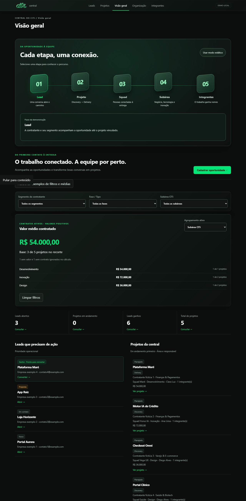
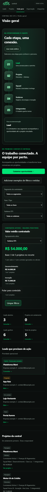
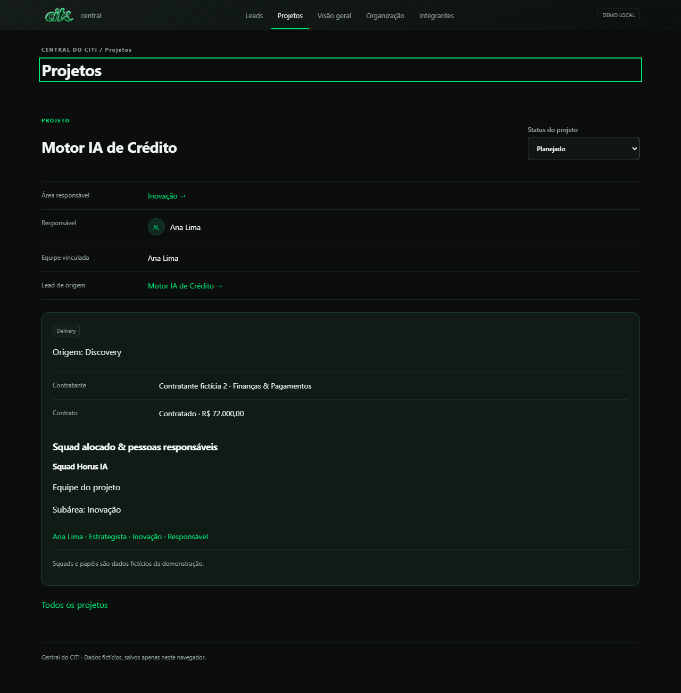
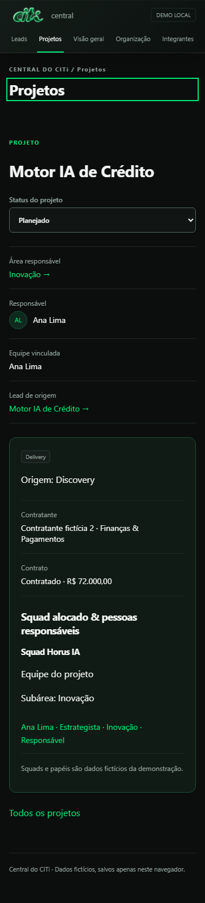

# Esteira, médias e apresentação do CITi

Implementação baseada em `main` 981609f, com a refatoração Controller → Service → Repository integrada. A aprovação foi conferida na conversa de Produto: respostas do usuário em 14/11/2026 às 13:42 (Fortaleza), liberando fases evolutivas, dupla visão de médias, campos mínimos, visual e logo do PDF. O pedido posterior do usuário substituiu High por Medium.

## Abrir a aplicação

Na revisão de alterações, use **Preview** em `previa/index.html`. Essa é a aplicação React compilada, com CSS, JavaScript, logo e módulo da cena em arquivos relativos; funciona sem instalação. `proposta-visual/` é o protótipo histórico aprovado, não a aplicação final.

Para executar nesta máquina:

```sh
npm ci
npm run dev
```

Para servir a compilação versionada: `npm run preview -- --port 5186 --strictPort`, depois abra `http://localhost:5186`. Não use abertura direta via `file://`, pois os módulos JavaScript precisam de servidor HTTP.

## Percurso de avaliação

1. Abra Leads, cadastre nome da oportunidade, organização e contato. Informe segmento e, opcionalmente, valor estimado. Edite o estágio para Ganho e salve.
2. No mesmo detalhe, confira a contratante. Converta usando subárea, responsável, fase inicial, nome do squad e contrato/valor; outros integrantes são opcionais. O nome do squad é gerado quando vazio.
3. O projeto abre vinculado ao lead, com sua fase, valor, squad, subárea e pessoas. Discovery pode avançar para Delivery no mesmo registro; origem, vínculo e contrato são preservados. A área abre os integrantes e projetos relacionados.
4. Volte ao lead pelo vínculo e abra o mesmo projeto. Recarregue para conferir persistência e ausência de duplicação.
5. Na Visão geral, clique em **Adicionar exemplos de filtros e médias**. A ação acrescenta cinco exemplos sem substituir registros e é idempotente; não carrega exemplos repetidos. Nomes, empresas e squads são fictícios.
6. Sem outros projetos elegíveis, a média será **R$ 54.000,00**, base **3 de 5 projetos**. Há um sem valor e um sem contrato. Alterne o agrupamento entre Subárea CITi e Segmento da contratante.
7. Combine Finanças & Pagamentos + Discovery + Inovação: **R$ 72.000,00**, base **1 de 1**. Limpe e escolha Saúde & Biotech: **sem elegíveis**, base **0 de 1**. Na lista Projetos, os mesmos filtros combinam também com status e área já existentes.
8. Na cena de entrada, use ponteiro, toque ou teclado para selecionar estações e ler notas. Alterne para modo estático. A preferência de movimento reduzido e a falta de suporte a CSS 3D ativam automaticamente a apresentação plana.

Os dados continuam locais à origem do navegador, sob `central-citi-v1`. Abrir a prévia em uma origem diferente não transfere registros entre origens. Não há backend compartilhado nem autenticação neste recorte.

## Regras, arquitetura e compatibilidade

- Componentes acionam Controllers; estes coordenam persistência e consultas do Service. Conversão 1:1, avanço de fase, filtros, elegibilidade, médias e inclusão da demo ficam no Service. Repository concentra leitura, escrita e hidratação de dados antigos.
- A média usa somente `contractStatus === 'Contratado'` e valores numéricos finitos maiores que zero, após a interseção dos filtros. `Sem contrato` é excluído mesmo quando tem valor. Sem elegíveis retorna `null`, exibido como travessão e explicação.
- Dados antigos mantêm ids, campos extras e vínculos. Campos ausentes recebem segmento Não classificado, fase Delivery, valor nulo e squad derivado do projeto, sem inventar contratos monetários. A leitura não grava automaticamente; a próxima alteração válida persiste a estrutura hidratada. Dados ilegíveis não são sobrescritos.
- A demo preserva o vínculo 1:1: o exemplo sem contrato possui seu próprio lead. Isso corrige a duplicação do lead `l5` entre dois projetos no protótipo de Produto. Também foi corrigido o identificador inválido `sub Focus` no JavaScript daquele protótipo para permitir sua consulta histórica.
- O componente de lista de projetos foi extraído do corpo de App, evitando recriação do tipo em cada render. Filtros usam parâmetros hash e preservam busca, rotas e controles anteriores. O botão magnético mantém o elemento clicável fixo e move só sua pintura.
- A cena foi produzida em paralelo após validar o contrato `{activeStep, metricsSummary, onSelectStep, forceStatic}`, limitada a `EsteiraScene3D.jsx` e `esteira3d.css`. Não acessa estado persistido. Usa profundidade CSS e paralaxe sob demanda, sem WebGL, GSAP ou dependências novas. O módulo JavaScript tem aproximadamente 4,2 kB antes de gzip. Falha no carregamento tem alternativa textual navegável.
- Skills aplicadas: react-patterns e vercel-react-best-practices. GSAP não foi usado. Removida a fonte externa da aplicação para evitar dependência de rede na prévia.

## Fontes e limites institucionais

Entrada integral: [proposta aprovada](PROPOSTA_ESTEIRA_MEDIAS.md), obtida da branch de Produto `tds/conv-01a1dad5-f7d5-7155-b71a-d25eb8108d0f`, incluindo `proposta-visual/` e seus ativos.

O [PDF do desafio](DesafioDeInovaçãoPS.pdf), páginas 1–2, foi relido via extração de texto com pypdf nesta implementação: confirma o time de Inovação, uso de IA, visão de negócio e orientação a soluções com padrão de startup. A logo em `proposta-visual/assets/` é o ativo extraído do PDF, aprovado pelo usuário; não foi redesenhada.

As explicações de Discovery/Delivery e organização dos squads são decisões operacionais aprovadas para a demonstração, com rótulos próprios na cena. Não foram apresentadas como metodologia institucional documentada. Subáreas além de Inovação e todos os nomes da demo são fictícios.

## Validação

Ambiente: Windows/PowerShell, Node 24.14.1, Chromium via Playwright.

| Comando | Resultado |
| --- | --- |
| `npm ci` | Instalação concluída, sem vulnerabilidades reportadas |
| `npm test` | 8 testes de domínio aprovados |
| `npm run build` | Build de produção concluído |
| `npm run test:e2e` | 16 testes de navegador aprovados |
| `npm run build:preview` | Compilação relativa em `previa/` |
| `npm run check:preview` | Prévia comparada byte a byte com build independente |
| `npm run test:preview` | 16 testes aprovados também contra a prévia compilada |
| `git diff --check` | Sem erros de whitespace |

Cobertura: média por ambas as dimensões, interseção/recorte vazio, valores inválidos, ausência de contrato/valor, idempotência da demo, avanço no mesmo projeto, migração anterior com extensões, falhas de armazenamento, percurso completo, teclado, hit area magnética, persistência, mobile sem overflow, carga condicional da cena e alternativas estáticas.

Os testes existentes foram preservados, ajustando a expectativa de hidratação dos projetos antigos e a posição da ação após a entrada da cena. Durante a validação, a mudança de altura com movimento reduzido exigiu recalcular a posição no teste do botão; a troca rápida de filtros revelou uso de parâmetros antigos, corrigido para ler o hash corrente.

## Capturas da aplicação

Desktop 1280 px e celular 360 px; geradas pela suíte Playwright, sem dados reais:









As capturas anteriores `evidencias/desktop-*.png` e `mobile-*.png` também foram atualizadas pelo percurso completo. O foco verde visível nos títulos em algumas capturas é o foco de navegação acessível.

## Entrega e revisão

As alterações são entregues na branch desta conversa `tds/conv-01a1daf2-b3ee-723a-96a5-f5155a24f7b3`, conforme o fluxo da plataforma, sem criar outra branch. A revisão de alterações contém o diff e esta documentação. A revisão por IA solicitada usa o agente Revisor, configurado em GitHub Copilot. O merge aguarda a revisão e aprovação do usuário.
