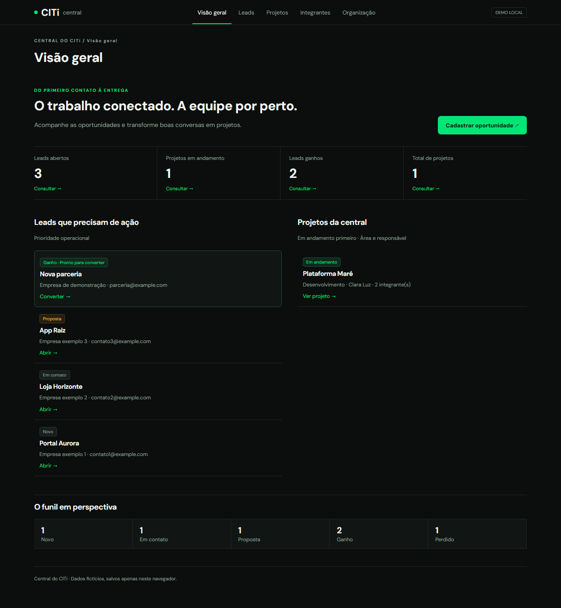
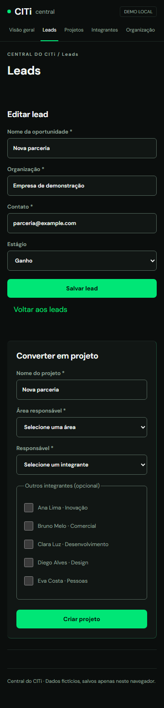

# Redesign React — entrega para aprovação visual

Abra **Preview** no arquivo `previa/index.html` na revisão de alterações desta tarefa. É a aplicação React compilada, com CSS e JavaScript relativos versionados; permite testar os fluxos sem instalar ferramentas. Os dados são fictícios e ficam no armazenamento do navegador. A prévia começa com os dados originais, sem projetos; as capturas usam um cenário adicional descrito abaixo.

## Como testar

1. Na página inicial, confirme a ordem: Ganho sem projeto, Proposta, Em contato, Novo. Perdidos e ganhos já convertidos não entram nessa fila. Leads abertos continua contando somente Novo, Em contato e Proposta.
2. Abra Plataforma Maré, selecione Desenvolvimento e Clara Luz na conversão, acrescente Ana Lima e clique em Criar projeto. Qualificação e conversão aparecem lado a lado em desktop e empilhadas no celular.
3. Mude o status do projeto para Em andamento e recarregue. Abra Desenvolvimento, confira pessoas e projeto vinculado, volte ao projeto e abra seu lead de origem. O estágio permanece bloqueado em Ganho e não permite duplicar o projeto.
4. Experimente buscas e filtros nas cinco seções. Cadastre uma oportunidade e teste os campos obrigatórios. Verifique os indicadores após salvar.
5. No desktop, aproxime o cursor das bordas dos botões principais e clique: somente a pintura se desloca, até 4 px. Ao sair, ela retorna. No celular, confira o realce ao pressionar. Use Tab e Enter, observe o foco verde e ative movimento reduzido no sistema: deslocamentos e transições desaparecem.

Para executar o código localmente: `npm ci`, `npm run dev -- --port 5186 --strictPort`, abra `http://localhost:5186`. Para reproduzir a compilação versionada: `npx vite build --base ./ --outDir previa`. Não abrir o HTML por `file://`; use o Preview ou um servidor HTTP.

## Capturas da aplicação

Capturas Chromium em 1280 × 900 e 360 × 900, de página inteira. Cenário exclusivo das capturas: Plataforma Maré convertida com Clara Luz e Ana Lima, em andamento; Nova parceria como ganho ainda sem projeto. Não modifica a carga inicial nem dados do usuário. São regeneradas por `npm run test:e2e`.

| Etapa | Desktop | Celular |
| --- | --- | --- |
| Inicial | [Captura](evidencias/desktop-inicio.png) | [Captura](evidencias/mobile-inicio.png) |
| Lead e conversão | [Captura](evidencias/desktop-lead.png) | [Captura](evidencias/mobile-lead.png) |
| Projeto | [Captura](evidencias/desktop-projeto.png) | [Captura](evidencias/mobile-projeto.png) |
| Área | [Captura](evidencias/desktop-area.png) | [Captura](evidencias/mobile-area.png) |

## Verificação e contribuição

Implementador · Codex: cabeçalho superior, composição por divisórias nas cinco seções, prioridades na inicial, percurso integrado, camada magnética reutilizável, resposta ao toque, foco, movimento reduzido e capturas. Formulários foram extraídos para componentes estáveis; salvar não remonta o formulário. Foco após navegação é aplicado antes da pintura, evitando que um callback atrasado interrompa a digitação.

Resultados em 13/11/2026, Fortaleza:

- `npm test`: 2 testes existentes aprovados, saída 0.
- `npm run test:e2e`: 6 testes aprovados, saída 0. Inclui os 2 existentes sem alterar seus seletores, fluxo completo, persistência, erros de armazenamento, filtros, teclado, ausência de overflow em 360/1280, prioridade, precisão de clique, retorno do efeito e movimento reduzido, percurso e capturas com contexto de toque.
- `npm run build`: aprovado; compilação relativa para `previa/` também aprovada.
- `git diff --check`: sem erros.

A porta da suíte passou para 5186 com servidor exclusivo e `strictPort`: havia outra aplicação em 5173. A primeira execução nessa porta antiga foi descartada como evidência desta entrega. Os resultados acima são do servidor desta branch. Durante a execução isolada, foi corrigida uma corrida de foco ao navegar por teclado; a suíte completa foi repetida após a correção.

Base lida integralmente: `PROPOSTA_REDESIGN.md` e os três arquivos do protótipo `proposta-visual/`, branch de Produto `tds/conv-01a1d7a0-668c-797d-ad83-a7d1ff9a04c9`; aprovação do cartão confirmada na conversa de Produto. Não há ambiguidade material bloqueante. Controles do simulador e dados fixos do protótipo foram adaptados para navegação real e estado existente. Contornos de campos usam contraste mais forte que a divisória estrutural.

Skills utilizadas sob demanda: vercel-react-best-practices da biblioteca (`neGYGk5pqLrLmpfc5CwBO`) e react-patterns da fonte preservada em `skills-import/sources/react-patterns/SKILL.md` da branch de importação `tds/conv-01a1d7a0-5ea1-7916-a1e5-7376e655ffd9`. SHA-256 conferido contra manifesto: `f3208d44a5d553038c42e046cec4dc16e4a3d90a9dbf931f883a2e21919a64a9`, 11466 bytes. As referências transversais externas à pasta da skill não integram a cópia preservada; foram usados os princípios e exemplos completos do SKILL.md. Sem GSAP ou novas bibliotecas de animação.

Revisão solicitada ao Revisor GitHub Copilot, incluindo react-doctor da fonte preservada na tarefa de importação, percurso, cliques precisos, mobile, teclado e movimento reduzido. Este registro não antecipa seu parecer. A verificação automatizada de toque é emulada no Chromium; não equivale a teste físico em iOS/Android. A fonte DM Sans mantém o carregamento externo já existente e possui fallback de sistema.

Entrega na branch desta conversa, conforme fluxo da plataforma. **Expansão e mesclagem em main aguardam aprovação visual do usuário.**

## Conferência após a correção sobre a stack

Implementador · Codex conferiu o código efetivo: `index.html` carrega `src/main.jsx`, que importa React e monta `<App/>` via `createRoot`; `Magnetic.jsx` é um componente React. A prévia carrega os bundles gerados dessa entrada pelo Vite. Não foi encontrada divergência: a compilação independente comparou os três arquivos de `previa/` byte a byte e todos coincidiram. O protótipo de Produto continua sendo referência visual, não a aplicação entregue.

Acrescentei comandos explícitos de compilação, execução e verificação da prévia e uma configuração Playwright que serve o build real. `README.md` explica como executar a aplicação. Node.js executa as ferramentas Vite e os testes; não foi solicitado nem criado um backend. Versões efetivamente instaladas nesta conferência: Node.js 24.14.1, React/React DOM 19.3.1 e Vite 7.3.8 (as faixas declaradas no pacote são ^19.2.0 e ^7.2.0).

Verificação nesta rodada:

- `npm run check:preview`: saída 0, compilação independente aprovada e três arquivos idênticos, incluindo JS e CSS.
- `npm test`: saída 0, dois testes de domínio aprovados.
- `npm run test:preview`: saída 0, seis testes aprovados sobre a aplicação compilada; inclui percurso, persistência, filtros, teclado, clique durante efeito, movimento reduzido e contextos desktop/mobile. Teste mobile permanece emulação Chromium.
- `git diff --check`: saída 0.

As seis skills atribuídas foram recarregadas da biblioteca, sem alterar configurações dos agentes:

| Skill | Aplicabilidade nesta conferência |
| --- | --- |
| vercel-react-best-practices (`neGYGk5pqLrLmpfc5CwBO`) | Conferidos estado derivado, imports diretos, inicialização preguiçosa e limpeza do listener de navegação. Sem memoização especulativa. |
| react-patterns (`fJXdIyR6Hsl4W87Klldyw`) | Agora carregada da biblioteca. Conferidos componentes React, composição, hooks no topo, labels e gerenciamento de foco. Não é necessário recuperar a cópia antiga para esta rodada. |
| gsap-react (`ajI1dgRafMXzItg8JGg-1`) | Lida; padrões de useGSAP/contexto só se aplicam a código GSAP. Mantido o efeito CSS/React já aprovado, sem migração de animação nesta conferência de stack. |
| react-hook-form (`RVhP38LUka_kLVVV8faMP`) | Lida; regras de useForm/useWatch específicas da biblioteca não se aplicam aos formulários controlados existentes. Não introduzida migração de formulários nesta correção de pipeline. |
| react-native-best-practices (`Z3see01MpyGN1zyY65t7P`) | Lida; aplicação web React DOM, sem Hermes, Metro ou módulos nativos. Mantido o princípio de não otimizar sem medição. |
| clerk-react-patterns (`q7uNBMMfXYV080tQagC1s`) | Lida; não há autenticação Clerk neste recorte. Não adicionados login, provider ou novas credenciais. |

Nenhuma mudança de visual, regra de negócio, autenticação ou plataforma nativa. A indicação de espera visual como tratada não foi interpretada como autorização para merge.
