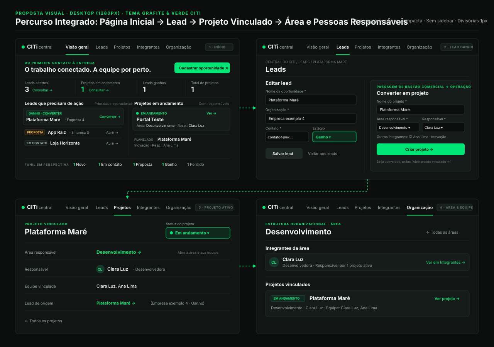
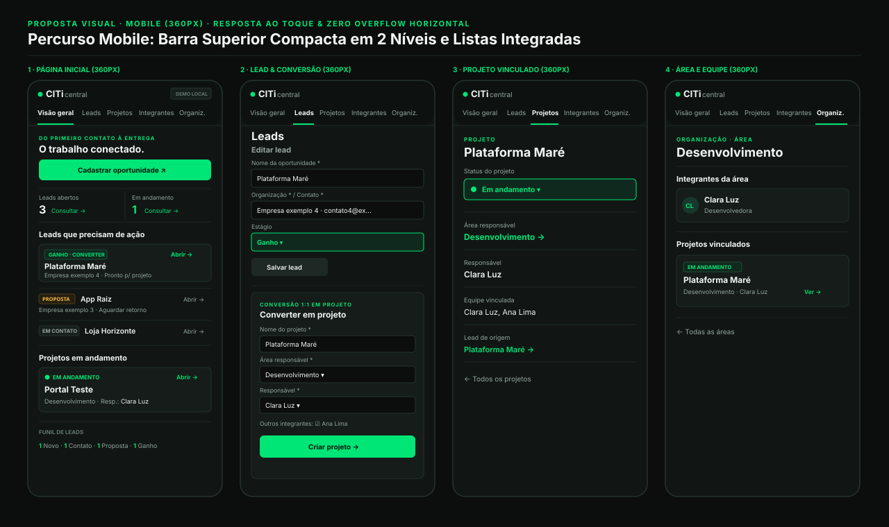
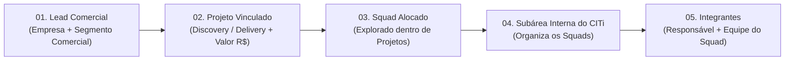

# Produto · Validação da Esteira, Modelo de Dados, Médias e Direção Visual (#9)

> **Tarefa:** [#9 Produto · validar esteira, médias e direção visual](todo:Z9babPL9Y5IjC5C7Y_1_w)
> **Agente responsável:** **Produto · Antigravity** (Gemini 4 Argon)
> **Base inspecionada:** `main` em `981609fa00faa52bff8c980584b54b636ca851f5` (contendo o redesign implementado na 2ª rodada e a refatoração `Controller / Service / Repository` de [#8](todo:M0_0a-Gya_VhQOL36HjAG) em `81aab56`).
> **Status:** **Recorte, regras de negócio (Discovery/Delivery e Médias), logo do PDF e direção visual APROVADOS pelo usuário via cartão (`q-Mbfw0LBP79fW9Pt1Q-Cvz`)** — liberado como contrato de entrada para a implementação em [#10](todo:qCPs7J4fq0IFRA1tGIry-) e revisão em [#11](todo:_Dcu57niGSzjQbFxx35GT). Nenhum arquivo de código da aplicação (`src/*` ou `previa/*`) foi alterado nesta etapa.

---

## 1. Onde Abrir a Prévia Visual e os Artefatos desta Proposta

Na **Revisão de Alterações (Change Review)** desta tarefa, clique no botão **Preview** em qualquer um dos arquivos versionados abaixo:

1. **[Protótipo Interativo Desktop & Mobile (`proposta-visual/index.html`)](proposta-visual/index.html)** — permite alternar ao vivo entre **Desktop (`1280px`)** e **Celular (`360px`)**, testar a **Cena 3D interativa da esteira** e sua **Alternativa Estática (Reduced Motion)**, aplicar **filtros combinados em Liquid Glass** (*Segmento da Contratante + Discovery/Delivery + Subárea do CITi*), alternar o **agrupamento do Valor Médio (`R$`)** e percorrer `Lead → Projeto → Squad → Subárea → Integrantes`.
2. **[Prancha Visual Desktop 1280px (`proposta-visual/desktop-percurso.svg`)](proposta-visual/desktop-percurso.svg)** — composição completa em alta definição para desktop.
3. **[Prancha Visual Mobile 360px (`proposta-visual/mobile-percurso.svg`)](proposta-visual/mobile-percurso.svg)** — composição responsiva vertical para celular (`360px`) sem rolagem horizontal.
4. **Ativos da Logo Oficial extraídos de `DesafioDeInovaçãoPS.pdf`:**
   - [`proposta-visual/assets/logo-citi-simbolo.png`](proposta-visual/assets/logo-citi-simbolo.png) — lettering oficial `citi` em verde institucional extraído diretamente do PDF (`10 0 obj` + `12 0 obj`);
   - [`proposta-visual/assets/logo-citi-dark.png`](proposta-visual/assets/logo-citi-dark.png) — assinatura `citi <> INOVAÇÃO` do PDF com luminância adaptada para fundo escuro;
   - [`proposta-visual/assets/logo-citi-pdf-original.png`](proposta-visual/assets/logo-citi-pdf-original.png) — recorte original sem alteração de cor extraído de `DesafioDeInovaçãoPS.pdf`.

### Prévia Integrada — Desktop (`1280px`)

### Prévia Integrada — Celular (`360px`)

---

## 2. Distinção entre Fonte Confirmada, Hipótese da Demo e Decisão Pendente

Em cumprimento estrito às restrições da tarefa (*"Distinguir fonte confirmada, hipótese e decisão pendente. Não inventar logo ou fatos do CITi"*), toda informação exibida na proposta e prevista para as notas de contexto na implementação obedece à classificação abaixo:

| Categoria Epistêmica | O que é | Fonte / Status |
| :--- | :--- | :--- |
| **1. Fato Confirmado** | - O **CITi** é a maior empresa júnior de tecnologia do Brasil, formando profissionais no Norte, no Nordeste e no país. - Dentro do CITi atua o **time de Inovação**, caracterizado pelo uso intenso de Inteligência Artificial em cada etapa, visão de negócio e construção de soluções com padrão de startup. - Cabeçalho oficial `citi <> INOVAÇÃO` presente no briefing (`2048×698` RGBA). | **Fonte confirmada:** [`DesafioDeInovaçãoPS.pdf`](DesafioDeInovaçãoPS.pdf) (páginas 1 e 2, objetos `10 0 obj` e `12 0 obj`). |
| **2. Fato Confirmado (Base Técnica)** | - Arquitetura React separada em `View → Controller → Service → Repository` (`81aab56`). - Persistência local sob a chave `central-citi-v1` com 5 estágios de lead (`Novo`, `Em contato`, `Proposta`, `Ganho`, `Perdido`), 3 status de projeto (`Planejado`, `Em andamento`, `Concluído`) e conversão 1:1 idempotente. | **Fonte confirmada:** `main` (`981609f`), [`RECORTE_PRODUTO.md`](RECORTE_PRODUTO.md), [`PROPOSTA_REDESIGN.md`](PROPOSTA_REDESIGN.md) e [`docs/refatoracao-lead-projeto.md`](docs/refatoracao-lead-projeto.md). |
| **3. Status da Logo Oficial** | - Não havia arquivo `.svg` ou `.png` isolado da marca no repositório fora do PDF. - Extraímos bit a bit a imagem oficial embutida em `DesafioDeInovaçãoPS.pdf` para `proposta-visual/assets/logo-citi-simbolo.png` e `logo-citi-dark.png`. - **Solicitação de anexo (opcional):** caso você possua e prefira usar um arquivo vetorial institucional (`.svg` ou `.png` sem o sufixo `<> INOVAÇÃO`), anexe-o na resposta ou envie-o pela aba **Files**; caso contrário, a implementação utilizará o ativo oficial extraído do PDF. | **Fonte confirmada:** `DesafioDeInovaçãoPS.pdf` + **Verificação com o usuário**. |
| **4. Hipótese / Recorte Demonstrativo** | - Nomes dos squads fictícios (*Squad Maré*, *Squad Horus IA*, *Squad Vega UX*), subáreas complementares além de Inovação (*Desenvolvimento*, *Design*, *Comercial*, *Pessoas*) e segmentos de clientes (*Finanças & Pagamentos*, *Varejo & E-commerce*, *Saúde & Biotech*). - Notas explicativas da demo sobre **Discovery** (etapa de entendimento do problema, validação de escopo e prototipação) e **Delivery** (etapa de desenvolvimento, ciclos de entrega e implantação). | **Hipótese operacional da demo** (identificada explicitamente como tal nas notas da interface; não atribuída como documento institucional oficial sem material adicional). |
| **5. Decisões Validadas pelo Usuário** | 1. **Discovery e Delivery (Aprovada Opção 1A):** fases evolutivas que um mesmo projeto pode percorrer (nasce em `Discovery` ou `Delivery` e pode evoluir de `Discovery` para `Delivery` no detalhe sem duplicar o vínculo 1:1 com o lead). 2. **Agrupamento do Valor Médio (Aprovada Visão Dupla):** alternância e comparação entre *Subárea interna do CITi* e *Segmento da empresa contratante*. 3. **Regra de elegibilidade da média (Aprovada):** entram na média apenas projetos com `contractStatus === 'Contratado'` e `contractValue > 0` no recorte dos filtros ativos, com estado vazio claro quando `eligibleCount === 0`. 4. **Campos mínimos, percurso, direção visual e logo (Aprovados):** percurso `Lead → Projeto → Squad → Subárea → Integrantes` começando em `Leads → Projetos`, Liquid Glass, cena 3D com alternativa estática e uso da logo oficial extraída de `DesafioDeInovaçãoPS.pdf`. | **Validado e aprovado pelo usuário via cartão (`q-Mbfw0LBP79fW9Pt1Q-Cvz`)**. |

---

## 3. Modelagem do Percurso Principal e da Navegação

### 3.1. Percurso Conectado: `Lead → Projeto → Squad → Subárea → Integrantes`
O fluxo principal deixa de tratar áreas e integrantes apenas como cadastros paralelos e passa a conectá-los como uma **esteira contínua de 5 estações**:

### 3.2. Ordem da Navegação Superior Compacta
- Conforme solicitado (*"A navegação deve começar em Leads, seguida de Projetos"*), a barra de navegação superior em **Liquid Glass** ordena os itens primários iniciando em:
  1. **`Leads`** (`#/leads`) — ponto de partida comercial da esteira;
  2. **`Projetos`** (`#/projetos`) — acompanhamento de execução (*Discovery* / *Delivery*), valor contratado e exploração direta dos **Squads**, sua **Subárea** e **Responsáveis**;
  3. **`Visão geral` / `Esteira & Médias`** (`#/`) — vitrine 3D/estática da esteira, indicadores operacionais e painel de **Valor Médio Contratado (`R$`)**;
  4. **`Organização` / `Subáreas`** (`#/organizacao`) — subáreas internas do CITi com seus squads e projetos;
  5. **`Integrantes`** (`#/integrantes`) — diretório de pessoas vinculadas aos squads e subáreas.
- **Compatibilidade de rotas:** Todas as 5 rotas hash (`#/leads`, `#/projetos`, `#/`, `#/organizacao`, `#/integrantes`) e seus parâmetros de busca/filtro permanecem válidos para não quebrar nenhum teste existente.

### 3.3. Exploração de Squads dentro de Projetos
Dentro da listagem de **Projetos** (`#/projetos`) e no detalhe de cada **Projeto** (`#/projetos/:id`), o usuário visualiza e explora diretamente o **Squad** responsável:
- **No cartão/linha do projeto:** exibe o selo **`Discovery`** ou **`Delivery`**, o **Valor Contratado (`R$`)** (ou aviso de *Sem valor* / *Sem contrato*), o **Segmento da Contratante**, o **Nome do Squad** (ex.: *Squad Maré*), a **Subárea interna do CITi** (ex.: *Desenvolvimento*) e a **Pessoa responsável** (ex.: *Clara Luz*).
- **No detalhe do projeto (`#/projetos/:id`):** inclui o bloco dedicado **"Squad Alocado & Pessoas Responsáveis"**, mostrando:
  1. Nome e foco do **Squad**;
  2. Link direto para a **Subárea interna do CITi** que organiza aquele squad (`#/organizacao/:areaId`);
  3. Lista das **Pessoas responsáveis** (destacando o **Responsável / Líder do Squad** e os demais **Integrantes do Squad**, com seus papéis e subáreas).

---

## 4. Decisão 1 para Validação: Discovery vs. Delivery

> **Pergunta do Spec:** *"Cada projeto deve indicar se é Discovery ou Delivery. Se o CITi tratar esses termos como fases que um mesmo projeto pode percorrer, traga essa decisão para validação."*

Apresentamos duas alternativas para sua escolha:

### Opção 1A (Recomendada) — Fases evolutivas que um mesmo projeto pode percorrer (`phase: 'Discovery' | 'Delivery'`)
- **Como funciona:**
  - Na conversão do Lead em Projeto, o usuário define em qual fase o projeto inicia (`Discovery` por padrão para imersão/escopo, ou direto em `Delivery`).
  - No detalhe do projeto (`#/projetos/:id`), um projeto que começou em **`Discovery`** pode **avançar para `Delivery`** (transição de fase no mesmo projeto, registrando `originPhase: 'Discovery'` para rastreabilidade e mantendo o vínculo único `1:1` com o lead de origem).
  - Nos filtros da esteira e de valor médio, o filtro **"Fase / Tipo (`Todos` | `Discovery` | `Delivery`)"** filtra pelo estado atual (`project.phase`).
- **Por que recomendamos:** Evita duplicar projetos no sistema quando um mesmo contrato passa da descoberta para a implementação e reflete fielmente a continuidade da esteira.

### Opção 1B — Classificação / Tipo fixo por projeto
- **Como funciona:**
  - `Discovery` e `Delivery` funcionam como tipos estáticos de contrato definidos no momento da conversão do lead em projeto, sem botão de transição de fase no detalhe do projeto.

---

## 5. Separação Comercial vs. Interna e Proposta de Campos Mínimos

> **Requisito do Spec:** *"Separe o segmento da empresa contratante, usado no filtro comercial, da subárea interna do CITi, usada para organizar os squads. Proponha os campos mínimos para empresa, lead, projeto, valor contratado e squad."*

### 5.1. Separação Conceitual Estrita
1. **Segmento da Empresa Contratante (`clientSegment` — Dimensão Comercial Externa):**
   - Classifica o setor de mercado da organização cliente (ex.: `Finanças & Pagamentos`, `Varejo & E-commerce`, `Saúde & Biotech`, `Educação`, `Logística`).
   - É preenchido no **Lead** (cadastro comercial) e herdado pelo **Projeto** na conversão, alimentando o **filtro comercial** e a visão comercial de valor médio.
2. **Subárea Interna do CITi (`areaId` — Dimensão Operacional Interna):**
   - Classifica a estrutura interna do CITi (ex.: `Inovação`, `Desenvolvimento`, `Design`, `Comercial`, `Pessoas`).
   - Organiza os **Squads** e os **Integrantes** do CITi, sendo definida na **alocação operacional do projeto/squad** e alimentando o filtro interno de subáreas.

### 5.2. Campos Mínimos Propostos por Entidade (Retrocompatíveis com `central-citi-v1`)

| Entidade | Campos Mínimos Propostos | Tipo e Obrigatoriedade | Regra de Compatibilidade com Dados Anteriores (`central-citi-v1`) |
| :--- | :--- | :--- | :--- |
| **1. Empresa Contratante** *(integrada ao Lead/Projeto)* | - `company`: Nome da empresa cliente - `clientSegment`: Segmento de mercado da contratante - `contact`: E-mail ou contato principal no cliente | - `string` (obrigatório) - `string` (obrigatório; default `'Geral'` se legado) - `string` (obrigatório) | Mantém os campos `company` e `contact` já exigidos em `saveLead`; adiciona `clientSegment` com fallback `'Não classificado'` ao ler dados antigos do `localStorage`. |
| **2. Lead Comercial** (`state.leads[]`) | - `id`: Identificador único - `name`: Nome da oportunidade - `company`: Empresa contratante - `clientSegment`: Segmento da contratante - `contact`: Contato na contratante - `stage`: `'Novo' \| 'Em contato' \| 'Proposta' \| 'Ganho' \| 'Perdido'` - `estimatedValue`: Valor estimado em R$ (opcional na prospecção) - `projectId`: ID do projeto convertido (1:1) | - `string` (PK) - `string` (obrigatório) - `string` (obrigatório) - `string` (obrigatório) - `string` (obrigatório) - `enum` (obrigatório) - `number \| null` (opcional) - `string \| undefined` | Preserva 100% do contrato atual de `LeadForm` e `saveLead`. Se `clientSegment` não for enviado em chamadas legadas de teste, assume `'Geral'`. |
| **3. Projeto** (`state.projects[]`) | - `id`: Identificador único - `name`: Nome do projeto - `leadId`: Vínculo com o lead de origem - `clientSegment`: Segmento da contratante (herdado do lead) - `phase`: `'Discovery' \| 'Delivery'` - `status`: `'Planejado' \| 'Em andamento' \| 'Concluído'` - `squadId`: Vínculo com o Squad alocado - `areaId`: Subárea interna do CITi responsável - `ownerId`: Pessoa responsável (líder do squad no projeto) - `memberIds`: Integrantes do squad no projeto | - `string` (PK) - `string` (obrigatório) - `string` (obrigatório) - `string` (derivado/herdado) - `enum` (default `'Discovery'`) - `enum` (default `'Planejado'`) - `string` (gerado/selecionado) - `string` (obrigatório) - `string` (obrigatório) - `string[]` (inclui `ownerId`) | Projetos já salvos na versão anterior recebem na leitura (`readState`) valores padrão seguros: `phase: project.phase \|\| 'Delivery'`, `clientSegment: lead?.clientSegment \|\| 'Geral'`, `squadId: project.squadId \|\| defaultSquadForArea(project.areaId)`. |
| **4. Valor Contratado** *(atributos contratuais do Projeto)* | - `contractStatus`: `'Contratado' \| 'Sem contrato'` - `contractValue`: Valor total contratado em reais (`R$`) | - `enum` (default `'Contratado'`) - `number \| null` (`> 0` quando informado; `null` quando sem valor) | Projetos anteriores sem `contractValue` são lidos com `contractValue: null` e `contractStatus: 'Contratado'` (ficando sinalizados como *Sem valor informado — fora da média*, sem corromper o cálculo). |
| **5. Squad** (`state.squads[]` ou vínculo operacional) | - `id`: Identificador do squad - `name`: Nome do squad (ex.: `Squad Maré`) - `areaId`: Subárea interna do CITi que organiza o squad - `ownerId`: Pessoa responsável pelo squad - `memberIds`: Lista de integrantes do squad - `specialty`: Foco técnico/operacional curto | - `string` (PK) - `string` (obrigatório) - `string` (FK → `areas.id`) - `string` (FK → `members.id`) - `string[]` (FK → `members.id`) - `string` (opcional) | Se `state.squads` não existir no JSON salvo anteriormente no navegador, `readState` hidrata os squads padrão a partir das subáreas e projetos existentes sem rejeitar o `localStorage`. |

---

## 6. Decisão 2 para Validação: Agrupamento do Valor Médio e Regras Explícitas de Elegibilidade

> **Requisito do Spec:** *"Valide comigo se a visão de valor médio por área deve agrupar por segmento da contratante, por subárea do CITi ou oferecer as duas visões. Para a demo, proponha uma regra explícita para projetos sem valor, projetos sem contrato e filtros ativos."*

### 6.1. Opções de Agrupamento da Visão de Valor Médio
1. **Oferecer as Duas Visões (Recomendado):**
   - O painel de **Valor Médio Contratado** permite alternar instantaneamente (ou visualizar lado a lado no desktop) entre:
     - **Visão Operacional — Por Subárea Interna do CITi** (ex.: ticket médio dos projetos alocados em *Inovação*, *Desenvolvimento*, *Design*); e
     - **Visão Comercial — Por Segmento da Contratante** (ex.: ticket médio contratado por clientes de *Finanças & Pagamentos*, *Varejo & E-commerce*, *Saúde & Biotech*).
2. **Agrupar apenas por Subárea Interna do CITi:** Foca exclusivamente na divisão interna de squads.
3. **Agrupar apenas por Segmento da Contratante:** Foca exclusivamente na visão de mercado comercial.

### 6.2. Regra Explícita para Projetos sem Valor, Projetos sem Contrato e Filtros Ativos

Para garantir transparência matemática na demonstração e nos testes automatizados (#10 e #11), propomos a seguinte regra determinística no `leadProjectService.js`:

1. **Critério de Elegibilidade (`isEligibleForAverage(project)`):**
   Um projeto entra no cálculo do valor médio se, e somente se, cumprir simultaneamente:
   - **Possuir contrato ativo:** `project.contractStatus === 'Contratado'` (projetos marcados como `'Sem contrato'` e leads ainda não convertidos em projeto são excluídos);
   - **Possuir valor numérico positivo:** `typeof project.contractValue === 'number' && Number.isFinite(project.contractValue) && project.contractValue > 0` (projetos com `contractValue === null`, `undefined`, `0`, `NaN` ou texto vazio são excluídos).

2. **Tratamento de Projetos Sem Valor (`contractValue == null` ou `<= 0`):**
   - **Não entram no numerador nem no denominador** da média (nunca contam como `R$ 0,00` para não distorcer a média para baixo).
   - Permanecem visíveis na lista de projetos com o selo explícito **`Sem valor (fora da média)`** e aparecem contabilizados no resumo do painel (`"X projeto(s) sem valor ignorado(s) no cálculo"`).

3. **Tratamento de Projetos Sem Contrato (`contractStatus !== 'Contratado'`):**
   - **Não entram no numerador nem no denominador** do valor médio contratado.
   - Permanecem visíveis na lista de projetos com o selo **`Sem contrato (fora da média)`** e são contabilizados no rodapé do painel (`"Y projeto(s) sem contrato ignorado(s) no cálculo"`).

4. **Comportamento com Filtros Ativos Combinados (`Segmento da Contratante` + `Discovery/Delivery` + `Subárea do CITi`):**
   - Os filtros ativos são aplicados primeiro por interseção lógica (**`AND`**) sobre a coleção de projetos:
     $$\text{Recorte} = \{ p \in \text{Projetos} \mid \text{passaSegmento}(p) \land \text{passaFase}(p) \land \text{passaSubarea}(p) \}$$
   - Sobre esse $\text{Recorte}$, filtra-se o subconjunto elegível:
     $$\text{Elegíveis} = \{ p \in \text{Recorte} \mid \text{isEligibleForAverage}(p) \}$$
   - Se $|\text{Elegíveis}| > 0$:
     $$\text{Valor Médio} = \frac{\sum_{p \in \text{Elegíveis}} p.\text{contractValue}}{|\text{Elegíveis}|}$$
     Exibe: **Média formatada em Reais (`R$`)**, **Quantidade usada no cálculo (`base: N de M projetos no recorte`)** e **Agrupamento ativo**.
   - **Estado Vazio Explícito (quando $|\text{Elegíveis}| === 0$):**
     Retorna `average: null` e `eligibleCount: 0` (nunca `0`, `NaN` ou `Infinity`) e exibe na interface: **`— Sem projetos elegíveis para média neste recorte`**, explicando quantos projetos foram filtrados ou excluídos por falta de contrato/valor e oferecendo o botão **`Limpar filtros`**.

---

## 7. Direção Visual Concreta (Desktop 1280px e Mobile 360px), Liquid Glass e Cena 3D

### 7.1. Identidade Visual (Preto/Grafite + Verde CITi + Liquid Glass)
- **Superfícies Base:** Preto grafite profundo (`#0B0E0D`) e grafite elevado (`#111614`), preservando os contrastes WCAG AA/AAA aprovados na rodada anterior.
- **Verde Institucional do CITi:** `#00E676` (acento primário, foco visível e indicadores principais) combinado ao esmeralda profundo `#00A859` (gradientes de barra e realces da logo oficial extraída do PDF).
- **Liquid Glass Adaptado à Web (Controles, Filtros e Menus):**
  - Aplicado na barra superior (`.topbar`), na barra de filtros combinados e nos painéis de inspeção:
    - Translucidez controlada: `background: linear-gradient(135deg, rgba(22, 31, 27, 0.78), rgba(13, 18, 16, 0.64))`;
    - Desfoque e saturação de fundo: `backdrop-filter: blur(18px) saturate(145%)`;
    - Borda especular direcional de `1px`: topo em `rgba(255, 255, 255, 0.14)` e laterais em `rgba(255, 255, 255, 0.07)` (ou `rgba(0, 230, 118, 0.34)` quando ativo);
    - Fallback sólido automático (`#121916`) via `@supports not (backdrop-filter: blur(10px))` para garantir legibilidade em qualquer navegador.
- **Botões Principais com Camada Móvel e Área Clicável Estável (`Magnetic.jsx`):**
  - Mantém exatamente a arquitetura aprovada: o elemento `<button>` / `<a>` externo nunca sofre `transform`, garantindo área de clique 100% fixa para o usuário e para o Playwright, enquanto `.btn-inner` desloca-se até `±4px` com o ponteiro no desktop (`pointer: fine` e sem `prefers-reduced-motion`), oferece resposta tátil `:active` no toque e mantém `:focus-visible` em verde `#00E676`.

### 7.2. Cena 3D Leve e Interativa na Entrada + Alternativa Estática
- **Inspiração e Propósito:** Inspirada no ritmo, na profundidade espacial e nas transições suaves das apresentações de produto da Apple, a entrada do portal apresenta os **5 estágios conectados da esteira** (`01. Lead → 02. Projeto [Discovery/Delivery] → 03. Squad → 04. Subárea → 05. Integrantes`) em planos com profundidade 3D interativa que respondem suavemente ao movimento do ponteiro e ao clique em cada etapa.
- **Notas Curtas Contextualizadas no Percurso:** Cada estação da cena exibe uma nota concisa sobre a etapa selecionada, distinguindo com selo visual o que vem do material confirmado (`DesafioDeInovaçãoPS.pdf`) do que é regra demonstrativa do fluxo.
- **Carregamento Sob Demanda e Alternativa Estática:**
  - O componente 3D é carregado sob demanda via `React.lazy(() => import('./views/EsteiraScene3D.jsx'))` dentro de `<Suspense>`.
  - Quando `prefers-reduced-motion: reduce` está ativo, em telas pequenas de toque se preferido, quando recursos gráficos 3D estão indisponíveis ou quando o usuário aciona o botão **"Modo estático"**, a cena renderiza instantaneamente sua **versão estática plana** sem paralaxe nem transições contínuas, mantendo todas as informações e ações acessíveis por teclado.

---

## 8. Limites de Arquitetura e Arquivos Compartilhados (Contrato para a Tarefa #10)

Conforme exigido pelas restrições da plataforma (*"Indicar arquivos compartilhados e limites para implementação e cena 3D"*), definimos a fronteira exata de módulos para que a implementação em [#10](todo:qCPs7J4fq0IFRA1tGIry-) possa isolar ou paralelizar a cena 3D sem conflito de arquivos:

| Camada / Entrega | Arquivos de Escopo Exclusivo | Contrato de Interface / Limite |
| :--- | :--- | :--- |
| **1. Módulo Isolado da Cena 3D** | - `src/views/EsteiraScene3D.jsx` *(novo)* - `src/views/esteira3d.css` *(novo, opcional)* | **100% desacoplado de estado/storage:** recebe apenas props `{ activeStep, metricsSummary, onSelectStep, forceStatic }`. Não importa `domain.js`, `stateRepository.js` nem `leadProjectService.js`. Inclui o fallback estático interno para `prefers-reduced-motion` ou indisponibilidade 3D. |
| **2. Domínio, Persistência e Regras de Negócio** | - `src/domain.js` - `src/repositories/stateRepository.js` - `src/services/leadProjectService.js` | - `domain.js`: exporta constantes (`stages`, `statuses`, `phases`, `clientSegments`, `seed` enriquecida com múltiplos segmentos, subáreas, squads e projetos dos dois tipos + casos sem valor/sem contrato). - `stateRepository.js`: preserva a chave `central-citi-v1` e aplica hidratação retrocompatível para dados já salvos. - `leadProjectService.js`: centraliza `saveLead`, `convert`, `changeStatus`, `changePhase` (se 1A for aprovada), `filterProjects` e `calculateAverageMetrics`. |
| **3. Controllers e Views Principais (Ponto de Integração)** | - `src/controllers/useCentralController.js` - `src/controllers/useLeadController.js` - `src/views/LeadForm.jsx` - `src/views/Conversion.jsx` - `src/main.jsx` - `src/style.css` | Os componentes React chamam apenas os Controllers, que coordenam as ações e invocam o Service. `src/main.jsx` monta `<EsteiraScene3D />` sob demanda e aplica o tema Liquid Glass e a navegação iniciando em `Leads → Projetos`. |

---

## 9. Registro da Contribuição desta Etapa (#9)

| Campo | Registro |
| :--- | :--- |
| **Tarefa** | [#9 Produto · validar esteira, médias e direção visual](todo:Z9babPL9Y5IjC5C7Y_1_w) |
| **Agente responsável** | **Produto · Antigravity** (Gemini 4 Argon) |
| **O que entregou** | 1. Especificação completa de produto, modelo de dados, regras de valor médio e direção visual em [`PROPOSTA_ESTEIRA_MEDIAS.md`](PROPOSTA_ESTEIRA_MEDIAS.md); 2. Extração sem invenção da logo oficial `citi <> INOVAÇÃO` embutida em [`DesafioDeInovaçãoPS.pdf`](DesafioDeInovaçãoPS.pdf) (`10 0 obj` + `12 0 obj`) para `proposta-visual/assets/logo-citi-simbolo.png`, `logo-citi-dark.png` e `logo-citi-pdf-original.png`; 3. Protótipo interativo atualizado em [`proposta-visual/index.html`](proposta-visual/index.html) (`style.css` + `app.js`) com navegação iniciando em `Leads → Projetos`, exploração de `Squad → Subárea → Integrantes`, filtros combinados em *Liquid Glass*, cálculo ao vivo do valor médio contratado e cena 3D interativa com modo estático; 4. Pranchas visuais SVG atualizadas para Desktop ([`proposta-visual/desktop-percurso.svg`](proposta-visual/desktop-percurso.svg)) e Mobile ([`proposta-visual/mobile-percurso.svg`](proposta-visual/mobile-percurso.svg)); 5. Delimitação explícita de arquivos compartilhados e contrato de isolamento para a implementação (#10) e revisão (#11). |
| **Como o resultado foi verificado** | - Inspeção de `DesafioDeInovaçãoPS.pdf` via script Node.js confirmando a extração exata dos streams `FlateDecode` (`2048×698` RGBA) e verificação visual das imagens geradas; - Teste de mesa da fórmula de valor médio contratado sobre a carga demonstrativa (3 projetos elegíveis somando `R$ 162.000,00` → média `R$ 54.000,00`; exclusão de 1 projeto sem valor e 1 projeto sem contrato; estado vazio verificado ao filtrar por `Saúde & Biotech`); - Execução de `npm test` (5/5 testes aprovados) e `git status` / `git diff --check` confirmando que nenhum arquivo de código de produção (`src/*`, `previa/*`) foi modificado antes da aprovação do usuário. |
