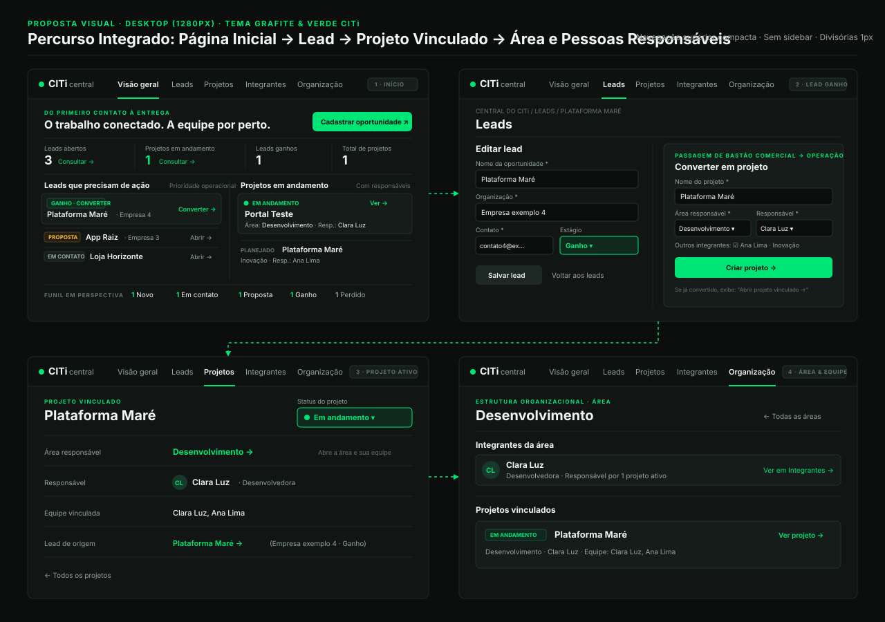
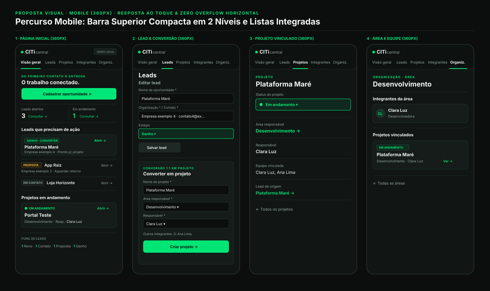

# Produto · Proposta de Redesign Desktop e Mobile da Central do CITi

> **Etapa 1 da Segunda Rodada (Redesign) — Produto · Antigravity (Gemini 4 Argon)**
> **Base inspecionada:** Implementação React entregue em `5041e86` e registrada em `1e88f2e` ([`src/domain.js`](src/domain.js), [`src/main.jsx`](src/main.jsx), [`src/style.css`](src/style.css), [`tests/domain.test.js`](tests/domain.test.js) e [`tests/flow.spec.js`](tests/flow.spec.js)).
> **Status:** **Proposta visual desktop/mobile e regra de priorização de leads APROVADAS pelo usuário via cartão** — liberado como contrato de entrada para a implementação em React ([#6](todo:vMnki51JVlJ2fhyIDKJMt)) e posterior revisão ([#7](todo:u_lBfqZUhbuyudoFdQtky)).

---

## 1. Onde Abrir a Prévia Visual desta Proposta

Você pode inspecionar a proposta visual diretamente na **Revisão de Alterações (Change Review)** desta tarefa clicando no botão **Preview** de qualquer um dos artefatos versionados abaixo, ou pela página **Files** da branch `tds/conv-01a1d7a0-668c-797d-ad83-a7d1ff9a04c9`:

1. **[Protótipo Interativo Desktop & Mobile (`proposta-visual/index.html`)](proposta-visual/index.html)** — permite alternar ao vivo entre **Desktop (1280px)** e **Celular (360px)**, percorrer os 4 passos integrados (*Página inicial → Lead → Projeto vinculado → Área e responsáveis*) e testar o efeito magnético sutil nos botões principais.
2. **[Prancha Visual Desktop 1280px (`proposta-visual/desktop-percurso.svg`)](proposta-visual/desktop-percurso.svg)** — visão completa em 4 quadros do percurso integrado no tema escuro grafite + verde do CITi.
3. **[Prancha Visual Mobile 360px (`proposta-visual/mobile-percurso.svg`)](proposta-visual/mobile-percurso.svg)** — visão das 4 telas celulares (`360px`) com navegação superior compacta e listas contínuas sem rolagem horizontal.

### Prévia Integrada — Percurso Desktop (1280px)

### Prévia Integrada — Percurso Mobile (360px)

---

## 2. Diagnóstico da Versão React Atual (`5041e86`) e Direção do Redesign

| Dimensão | Estado Atual (`5041e86`) | Proposta de Redesign (Grafite + Verde CITi) |
| :--- | :--- | :--- |
| **Tema e Paleta** | Fundo claro (`#f5f7f3`), cartões brancos (`#ffffff`) e verde escuro (`#133e33` / `#175b46`). | **Tema escuro em preto/grafite (`#0B0E0D` e `#111614`)** com destaque em **verde vibrante do CITi (`#00E676`)** de alto contraste e tipografia off-white (`#F1F5F3`). |
| **Navegação Principal** | Sidebar lateral esquerda fixa de `238px` (`<aside>`) ocupando espaço horizontal permanente no desktop. | **Navegação superior compacta (`56px` no desktop, 2 linhas enxutas no mobile)**, sem sidebar fixa, liberando toda a largura útil para o conteúdo. |
| **Organização da Informação** | Grade de caixas/cartões isolados (`.cards`, `.stats`, `.intro`) com bordas completas ao redor de cada item. | **Composição editorial integrada com menos caixas:** faixas horizontais contínuas separadas por **divisórias discretas de `1px` (`#1E2824`)**, hierarquia tipográfica clara e espaçamento respirável. |
| **Página Inicial (`Visão geral`)** | Exibe banner grande, 4 caixas de números, barra de funil e lista simples de projetos no rodapé (sem destacar os leads na página inicial). | **Prioriza lado a lado os leads que precisam de ação imediata e os projetos em andamento com sua área e pessoa responsável**, mantendo os indicadores e o funil em faixas compactas. |
| **Percurso Lead → Projeto → Área** | Formulários empilhados em caixas brancas separadas; navegação exige voltar para listas intermediárias. | **Percurso integrado em 4 passos:** *Página inicial → Lead (qualificação + conversão lado a lado) → Projeto vinculado (ficha técnica por divisórias) → Área e pessoas responsáveis*. |

---

## 3. Sistema Visual: Tokens de Cor, Tipografia, Espaçamento e Divisórias

### 3.1. Paleta Escura (Preto / Grafite & Verde CITi)
Todos os pares de cor foram calibrados para atender e superar o contraste **WCAG AA/AAA** sobre fundo escuro:

- **Superfície Principal (Canvas):** `#0B0E0D` (Preto Grafite Profundo)
- **Superfície Elevada (Destaque / Painel Ativo):** `#111614` (Grafite Operacional) e `#151D1A` (Hover de linha)
- **Divisórias Discretas (Hairlines `1px`):** `#1E2824` (estrutural) e `#2A3832` (controles de formulário)
- **Verde do CITi (Acento Primário e Foco):**
  - `#00E676` — Botões principais, indicador de rota ativa (`2px` inferior), links de percurso e anel de foco `:focus-visible` (contraste `11.8:1` sobre `#0B0E0D`).
  - `#04140B` — Texto escuro sobre botão primário `#00E676` (contraste `11.2:1`).
  - `#0F291E` (fundo) + `#1E4D38` (borda) + `#00E676` (texto) — Selo semântico para status ativos (`Ganho`, `Em andamento`, `Pronto para converter`).
- **Tipografia e Hierarquia de Cinzas:**
  - `#F1F5F3` — Texto primário, títulos e números (contraste `17.4:1`).
  - `#95A59E` — Metadados secundários: empresa, papel, área e contato (contraste `7.2:1`).
  - `#64756E` — Rótulos auxiliares e cabeçalhos de seção em caixa-alta.
- **Alerta / Erro Semântico:** `#FF6B6B` sobre superfície `#2A1215` (borda `#5C2328`).

### 3.2. Tipografia, Espaçamento e Menos Caixas
- **Fonte:** `DM Sans` (`400`, `500`, `600`, `700`) com `font-variant-numeric: tabular-nums` nos contadores para alinhamento vertical exato.
- **Substituição de Caixas por Linhas Arquiteturais:**
  - Os indicadores (`.stats`) deixam de ser 4 cartões soltos e passam a compor **uma faixa única dividida por fios verticais de `1px` (`#1E2824`)**.
  - As listagens de **Leads**, **Projetos**, **Integrantes** e **Áreas** usam **linhas contínuas (`border-bottom: 1px solid #1E2824`)** com `padding: 14px 12px`, reservando contorno fechado (`#1E4D38`) apenas para o item prioritário ou formulário de conversão.

---

## 4. Regra de Priorização de Leads na Página Inicial (Validada pelo Usuário)

> **Basis:** direção visual e percurso solicitados pelo usuário; regra submetida e **aprovada explicitamente pelo usuário via cartão de decisão** ("Aprovar priorização por urgência de ação"), preservando intacta a regra validada **H-05** (`Leads abertos = Novo + Em contato + Proposta`).

### Regra Proposta (`actionableLeads`):
Na página inicial (`#/`), a coluna **"Leads que precisam de ação"** lista os leads que exigem atuação da equipe (excluindo leads `Perdido` e leads `Ganho` que já foram convertidos em projeto), ordenados por urgência operacional:

1. **Prioridade 1 — `Ganho` ainda sem projeto vinculado (`stage === 'Ganho' && !lead.projectId`):**
   - **Destaque visual:** Selo verde CITi `Ganho · Pronto para converter` e ação direta **`Converter →`**.
   - **Por quê:** É o ponto crítico de passagem de bastão entre Comercial e Operação; não pode esfriar sem área e responsável definidos.
2. **Prioridade 2 — `Proposta` (`stage === 'Proposta'`):**
   - **Destaque visual:** Selo âmbar `Proposta` e ação **`Abrir →`**.
   - **Por quê:** Oportunidade na reta final de decisão do cliente.
3. **Prioridade 3 — `Em contato` e `Novo` (`stage === 'Em contato'` seguido de `stage === 'Novo'`):**
   - **Destaque visual:** Selo grafite discreto e ação **`Abrir →`** para qualificação e avanço no funil.

---

## 5. O Percurso Integrado (Desktop 1280px e Mobile 360px)

### Passo 1 · Página Inicial (`#/`) — Prioridades e Responsáveis Visíveis de Imediato
- **Cabeçalho Superior Compacto:** Marca `CITi central` à esquerda, as 5 seções (`Visão geral`, `Leads`, `Projetos`, `Integrantes`, `Organização`) centralizadas com sublinhado verde `#00E676` na rota ativa, e selo `DEMO LOCAL` à direita.
- **Faixa de Abertura Enxuta + Indicadores Acionáveis:** Título direto com botão magnético `Cadastrar oportunidade ↗` (`#/leads/novo`), seguido pela faixa horizontal dos 4 indicadores (`Leads abertos`, `Projetos em andamento`, `Leads ganhos`, `Total de projetos`) mantendo os rótulos e links filtrados existentes.
- **Visão Dupla Integrada (2 colunas no desktop, empilhadas por divisória no mobile):**
  - **Coluna Esquerda — Leads que precisam de ação:** Exibe os leads acionáveis ordenados pela regra acima; clicar em qualquer linha abre `#/leads/{id}`.
  - **Coluna Direita — Projetos em andamento (e projetos da Central):** Prioriza no topo os projetos com status `Em andamento` (destacados com ponto verde CITi), exibindo na mesma linha o **Nome do projeto**, a **Área responsável**, a **Pessoa responsável** (ex.: `Clara Luz`) e a quantidade de membros na equipe, levando direto a `#/projetos/{id}`.

### Passo 2 · Lead e Conversão Integrada (`#/leads/:id`)
- **Desktop (1280px):** Divisão editorial em 2 colunas separadas por fio vertical de `1px` (`#1E2824`):
  - **À esquerda (`Editar lead`):** Campos `Nome da oportunidade *`, `Organização *`, `Contato *` e `Estágio` (travado em `Ganho` após conversão, conforme H-01).
  - **À direita (`Converter em projeto` ou Vínculo Existente):** Quando o lead está em `Ganho` sem projeto, o formulário de conversão aparece imediatamente ao lado (sem precisar rolar por caixas empilhadas), solicitando `Nome do projeto *`, `Área responsável *`, `Responsável *` (filtrado pela área) e `Outros integrantes`. Quando já possui `projectId`, exibe o cartão de vínculo com o botão `Abrir projeto vinculado →`.
- **Mobile (360px):** As duas seções fluem em coluna única separadas por divisória horizontal de `1px`, com botões de largura total (`100%`) para toque confortável.

### Passo 3 · Projeto Vinculado (`#/projetos/:id`)
- **Cabeçalho do Projeto:** Exibe o nome do projeto e o seletor inline `Status do projeto` (`Planejado`, `Em andamento`, `Concluído`) com persistência imediata.
- **Ficha Relacional por Divisórias (`<dl>`):** Quatro linhas horizontais separadas por `1px solid #1E2824` que conectam todas as pontas do fluxo:
  1. **Área responsável:** Link direto e destacado em verde CITi (`Desenvolvimento →`) para `#/organizacao/{areaId}`.
  2. **Responsável:** Avatar em iniciais + nome do responsável da área (`Clara Luz`).
  3. **Equipe vinculada:** Lista completa separada por vírgulas (`Clara Luz, Ana Lima`).
  4. **Lead de origem:** Link reverso (`Plataforma Maré →`) para `#/leads/{leadId}`.

### Passo 4 · Área e Pessoas Responsáveis (`#/organizacao/:id`)
- Ao clicar na **Área responsável** dentro do projeto (ou navegar por `Organização`), a tela apresenta:
  - **Integrantes da área:** Lista por divisórias com avatar de iniciais, nome e papel (`Clara Luz · Desenvolvedora`).
  - **Projetos vinculados à área:** Lista integrada exibindo status (`Em andamento`), nome do projeto, responsável e link `Ver projeto →` de volta para `#/projetos/{id}`, fechando o ciclo completo.

---

## 6. Diretrizes de Microinterações, Cursor Magnético e Acessibilidade (Contrato para Implementação e Revisão)

Para orientar a implementação em React ([#6](todo:vMnki51JVlJ2fhyIDKJMt)) e a auditoria do Revisor ([#7](todo:u_lBfqZUhbuyudoFdQtky)):

1. **Botões Principais com Acompanhamento Leve do Cursor (Área Clicável Estável):**
   - O elemento clicável externo (`<button>` ou `<a className="button">`) mantém sua caixa geométrica **100% fixa no DOM** (garantindo que cliques rápidos e testes automatizados de Playwright nunca percam o alvo).
   - Uma camada visual interna (`.btn-inner` ou variáveis CSS `--tx`, `--ty` aplicadas via `transform: translate3d(...)`) desloca-se no máximo `±4px` na direção do ponteiro durante `pointermove` (apenas quando `matchMedia('(pointer: fine)')` e `prefers-reduced-motion: no-preference`) e retorna suavemente a `(0, 0)` em `pointerleave`.
2. **Transições Curtas e Resposta ao Toque no Celular:**
   - Transições de `140ms–180ms` (`ease-out`) ao abrir detalhes, alternar filtros e exibir o aviso de feedback (`role="status"`).
   - Em dispositivos de toque (`pointer: coarse` / mobile `360px`), o efeito de cursor fica desativado e os controles aplicam resposta tátil imediata em `:active` (`transform: scale(0.98)` e realce de borda `#00E676`).
3. **Teclado, Foco Visível e `prefers-reduced-motion`:**
   - `:focus-visible` com anel verde CITi de alto contraste (`outline: 2px solid #00E676; outline-offset: 3px`).
   - Preservação estrita da ordem de tabulação nas rotas de formulário: em `#/leads/novo`, o `<h1 tabIndex="-1">` recebe foco na mudança de rota e o primeiro `Tab` leva diretamente ao campo `Nome da oportunidade *` (nenhum controle interativo deve ser inserido entre `<h1>` e `<form>`).
   - Em `@media (prefers-reduced-motion: reduce)`, todas as animações, transições e deslocamentos magnéticos são desativados (`transition: none !important; transform: none !important`).
4. **Compatibilidade Integral com a Suíte Automatizada Existente:**
   - Todos os seletores semânticos verificados em [`tests/flow.spec.js`](tests/flow.spec.js) e [`tests/domain.test.js`](tests/domain.test.js) permanecem inalterados (`Leads abertos {n} Consultar`, `Projetos em andamento {n} Consultar`, `Cadastrar oportunidade`, `Salvar lead`, `Criar projeto`, `Abrir projeto vinculado`, `Status do projeto`, `Área responsável`, `Responsável *`, e ausência de overflow horizontal `scrollWidth <= innerWidth` em `360px` e `1280px`).

---

## 7. Status das Skills da Equipe e Entregas por Agente

### 7.1. Biblioteca de Skills React da Equipe (Tarefa [#4](todo:1HWiKZp2REoJRJLagGXg0))
Conforme conferido na biblioteca da plataforma (`skills`) e no relatório da tarefa [#4](todo:1HWiKZp2REoJRJLagGXg0) (branch `tds/conv-01a1d7a0-5ea1-7916-a1e5-7376e655ffd9`, arquivo `skills-import/RELATORIO.md`):

| Skill | Repositório de Origem | Status na Biblioteca da Equipe | Encaminhamento nesta Rodada |
| :--- | :--- | :--- | :--- |
| **`vercel-react-best-practices`** | `vercel-labs/agent-skills` | **Instalada e ativa** (`skillId: neGYGk5pqLrLmpfc5CwBO`; pulada na importação por já existir) | **Implementador** (sob demanda na tarefa [#6](todo:vMnki51JVlJ2fhyIDKJMt)) |
| **`react-patterns`** | `affaan-m/ecc` | **Pasta completa preservada em branch** (pendente de publicação no servidor MCP por bloqueio `predates directory import`) | **Implementador** (sob demanda na tarefa [#6](todo:vMnki51JVlJ2fhyIDKJMt)) |
| **`gsap-react`** | `greensock/gsap-skills` | **Pasta completa preservada em branch** (pendente de publicação no servidor MCP) | **Implementador** (condicional: usar somente se optar por GSAP) |
| **`react-doctor`** | `millionco/react-doctor` | **Pasta completa preservada em branch** (pendente de publicação no servidor MCP) | **Revisor** (sob demanda na tarefa [#7](todo:u_lBfqZUhbuyudoFdQtky)) |
| **`react-native-best-practices`** | `callstackincubator/agent-skills` | **Pasta completa preservada em branch** (pendente de publicação; biblioteca já conta com `vercel-react-native-skills` `X8eqgrKQpxM7W9Fv0VuFI`) | Biblioteca da equipe (sob demanda) |
| **`clerk-react-patterns`** | `clerk/skills` | **Pasta completa preservada em branch** (pendente de publicação no servidor MCP) | Biblioteca da equipe (sob demanda) |
| **`react-email`** | `resend/react-email` | **Pasta completa preservada em branch** (pendente de publicação no servidor MCP) | Biblioteca da equipe (sob demanda) |
| **`react-router-framework-mode`** | `remix-run/agent-skills` | **Pasta completa preservada em branch** (pendente de publicação no servidor MCP) | Biblioteca da equipe (sob demanda) |
| **`react-mcp`** | `assistant-ui/skills` | **Pasta completa preservada em branch** (pendente de publicação no servidor MCP) | Biblioteca da equipe (sob demanda) |
| **`react-hook-form`** | `pproenca/dot-skills` | **Pasta completa preservada em branch** (pendente de publicação no servidor MCP) | Biblioteca da equipe (sob demanda) |

### 7.2. Registro de Contribuição por Agente

| Etapa / Tarefa | Agente Responsável | O que Entregou | Como o Resultado foi Verificado |
| :--- | :--- | :--- | :--- |
| **1ª Rodada · Produto, Implementação e Revisão (`main`)** | **Produto · Antigravity**, **Implementador · Codex** e **Revisor · GitHub Copilot** | Recorte P0 validado ([`RECORTE_PRODUTO.md`](RECORTE_PRODUTO.md)), aplicação React funcional (`5041e86`) e registro de verificação e revisão ([`REGISTRO_RODADA.md`](REGISTRO_RODADA.md) em `1e88f2e`). | `npm test` (2/2), `npm run test:e2e` (2/2 em 360px e 1280px), `npm run build` e AI review aprovada sem achados. |
| **2ª Rodada · Importação de Skills ([#4](todo:1HWiKZp2REoJRJLagGXg0))** | **Implementador · Codex** | Conferência da `vercel-react-best-practices` já instalada (`neGYGk5pqLrLmpfc5CwBO`), recuperação integral das 9 skills restantes (127 arquivos com hashes SHA-256) e relatório de diagnóstico do bloqueio MCP em `skills-import/RELATORIO.md`. | Verificação de integridade dos 127 arquivos e manifesto SHA-256; teste de chamada `create_skill(dir)` documentado sem bloquear o redesign. |
| **2ª Rodada · Etapa 1: Proposta de Redesign ([#5](todo:yywCshmiUQmzm9Xp4uws7) — esta entrega)** | **Produto · Antigravity** (Gemini 4 Argon) | 1. Especificação completa do redesign desktop e mobile em [`PROPOSTA_REDESIGN.md`](PROPOSTA_REDESIGN.md) (tema escuro grafite + verde CITi, navegação superior compacta sem sidebar, composição por divisórias de `1px`, priorização de leads acionáveis e projetos em andamento com responsáveis); 2. Protótipo interativo navegável em [`proposta-visual/index.html`](proposta-visual/index.html) (`style.css` + `app.js`); 3. Pranchas visuais SVG de alta definição para Desktop ([`proposta-visual/desktop-percurso.svg`](proposta-visual/desktop-percurso.svg)) e Mobile ([`proposta-visual/mobile-percurso.svg`](proposta-visual/mobile-percurso.svg)). | - Inspeção de código contra [`src/main.jsx`](src/main.jsx), [`src/domain.js`](src/domain.js) e [`tests/flow.spec.js`](tests/flow.spec.js) para garantir preservação de 100% dos fluxos e seletores; - Execução de `npm test` (2/2 aprovados) e `git diff --check` confirmando que a base React permanece íntegra; - **Validação humana explícita:** aprovação pelo usuário via cartão (`q-NYL7mJYDTdjE2xT939J_z`) tanto da proposta visual desktop/mobile quanto da priorização de leads por urgência de ação. |
| **2ª Rodada · Etapa 2: Implementação React ([#6](todo:vMnki51JVlJ2fhyIDKJMt))** | **Implementador · Codex** | *Liberado após aprovação do usuário na Etapa 1 — acionado via Chief.* | Será verificado com `npm test`, `npm run test:e2e`, `npm run build` e capturas desktop/mobile. |
| **2ª Rodada · Etapa 3: Revisão de Percurso e Acessibilidade ([#7](todo:u_lBfqZUhbuyudoFdQtky))** | **Revisor · GitHub Copilot** | *Aguardando conclusão da Etapa 2 para executar AI review.* | Auditoria de percurso completo, precisão de clique com efeito magnético, mobile 360px, teclado e `prefers-reduced-motion`. |
