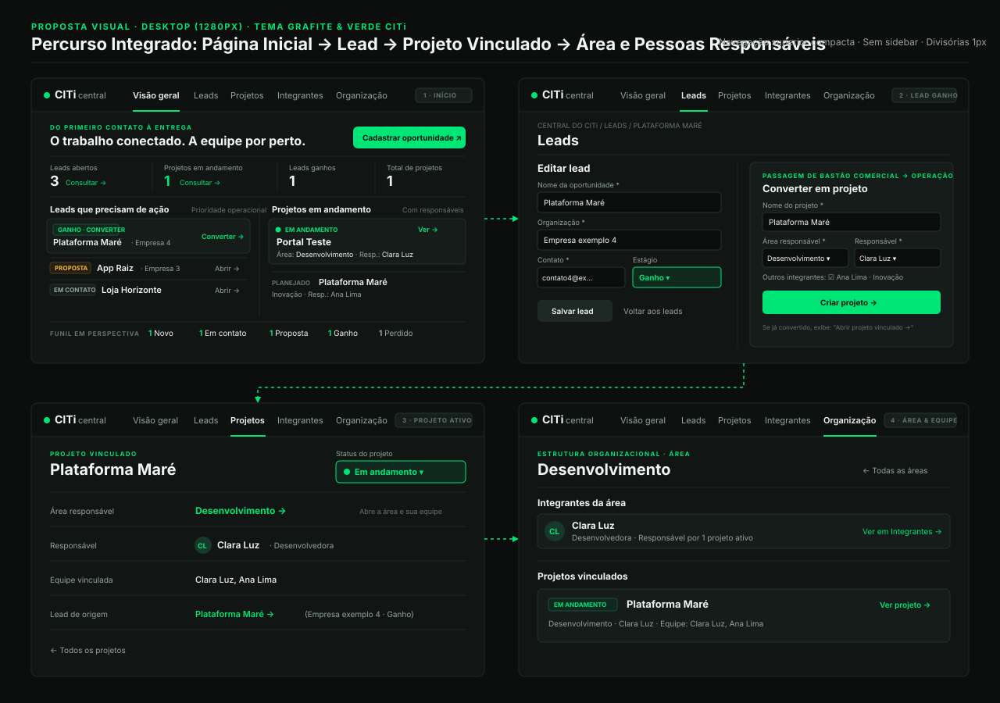
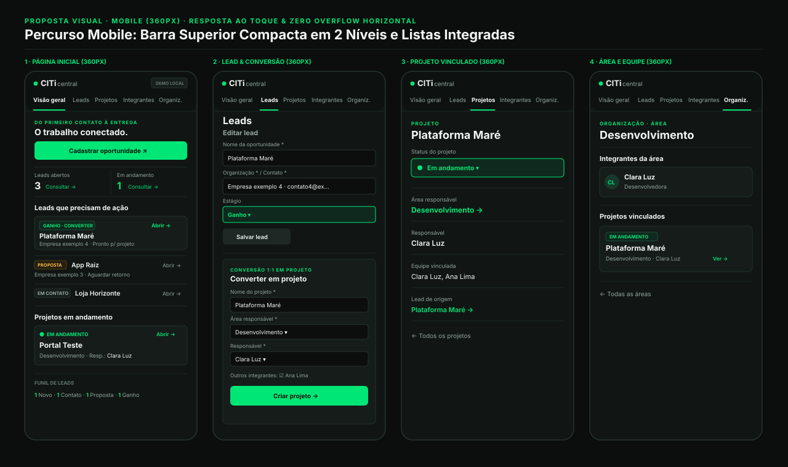

# Produto · Pesquisa de Transições 3D em React e Storyboard da Jornada com WaveMesh (#16)

> **Tarefa:** [#16 Produto · pesquisar transições 3D e desenhar jornada com WaveMesh](todo:3EC_vY_H6uleEwzt0lTtb)
> **Agente responsável:** **Produto · Antigravity** (Gemini 4 Argon)
> **Base inspecionada:** `main` em `05b3700f0863c65bf35549c5d72b858c96a9ceab` (contendo a aplicação React integrada com login `CITi/all`, `Visão geral` reorganizada, esteira comercial, filtros, médias, blocos de valor 20:1 e arquitetura `Controller → Service → Repository`).
> **Status:** **APROVADO pelo usuário via cartão (`q-ami14aGnEXwy3-p5kStTj`)** — confirmados: (1) **Direção A: Cena 3D com câmera animada sob demanda + fallback leve automático sem WebGL** sobre a instância única e persistente do `WaveMesh` em preto e verde do CITi; e (2) **Storyboard completo aprovado com ampliação da transição pós-login (`Login → Visão geral`) para `1,6s` (`1.600ms`, com teto de verificação de `1.800ms` na suíte E2E, substituindo o limite anterior de `1,2s`)**, incluindo a abertura `citi` em proporção original (`641×330`) + `/all` monoespaçado, os blocos interativos `20:1` (`Portal Aurora` × `Loja Horizonte`) com alvo mobile `≥ 68px` e a travessia `Lead → Projeto → Squad`. Liberado como contrato de entrada para [#17](todo:m82Rs2v9Mc76Co1lRfTiI) e [#18](todo:J0uMUsS_X5fd8UrrghnWC).

---

## 1. Onde Visualizar o Storyboard Interativo e os Artefatos Versionados

Na **Revisão de Alterações (Change Review)** desta tarefa, clique no botão **Preview** em qualquer um dos arquivos abaixo:

1. **[Storyboard & Simulador Interativo Desktop e Mobile (`proposta-visual/index.html`)](proposta-visual/index.html)** — executa ao vivo o **`WaveMesh` real em Canvas 2D (preto e verde do CITi)** em uma única instância persistente e permite simular passo a passo (ou automaticamente pelo botão **"▶ Simular Jornada Completa"**) as 6 etapas:
   - **Etapa 1 (`Abertura → Login`):** Logo oficial `citi` em suas proporções originais (`641×330`) centralizada ao lado de `/all` em fonte monoespaçada estilo editor de código (`/all▋`), seguida da revelação suave do formulário de login (com teste de erro inválido e simulação de atraso/falha do 3D provando que o login nunca bloqueia);
   - **Etapa 2 (`Login → Visão geral` com Transição 3D):** Passagem com profundidade, movimento de câmera no eixo `Z` e elementos 3D das estações em movimento, permitindo alternar ao vivo entre a **Direção A (Cena 3D + Câmera)** e a **Direção B (Alternativa Leve sem WebGL)**, e entre a duração **`1,15s` (dentro do limite `≤ 1,2s`)** e **`1,60s` (estendida)**;
   - **Etapa 3 (`Visão geral` & Troca de Abas):** Indicadores e Valor Médio na 1ª dobra e contador ao vivo comprovando que trocar de abas mantém **1 único canvas `WaveMesh` com `0` reinícios**;
   - **Etapa 4 (`Leads` · Comparação 20:1):** Blocos interativos de valor com **`Portal Aurora` (`R$ 200.000,00`)** × **`Loja Horizonte` (`R$ 10.000,00`, proporção `20:1`)**, agrupamento por **Etapa do funil** ou **Comparação direta**, acesso aos valores exatos e seleção do menor item no celular (`360px`, alvo `≥ 68px`);
   - **Etapa 5 (`Lead → Projetos` por Squad ou Fase):** Passagem do Lead para Projetos agrupados por **Squad e subárea** ou **Discovery / Delivery**;
   - **Etapa 6 (`Projeto → Squad`):** Chegada ao **Squad Aurora IA** / **Squad Horizonte** com responsável, integrantes e subárea sobre o mesmo `WaveMesh` contínuo.
2. **[Prancha do Storyboard Desktop 1280px (`proposta-visual/desktop-percurso.svg`)](proposta-visual/desktop-percurso.svg)** — storyboard visual completo em 6 quadros para desktop.
3. **[Prancha do Storyboard Celular 360px (`proposta-visual/mobile-percurso.svg`)](proposta-visual/mobile-percurso.svg)** — storyboard vertical para celular (`360px`), destacando a seleção sem erro de toque do menor bloco (`Loja Horizonte`, `5%`).
4. **[Fonte Original do `WaveMesh` Preservada (`docs/WaveMesh.original.tsx`)](docs/WaveMesh.original.tsx)** — cópia integral e inalterada do código `WaveMesh` fornecido pelo usuário, versionada como referência para a implementação em [#17](todo:m82Rs2v9Mc76Co1lRfTiI).

### Prévia Visual do Storyboard — Desktop (`1280px`)

### Prévia Visual do Storyboard — Celular (`360px`)

---

## 2. Pesquisa Pública de Transições 3D em React (R3F, GSAP para React e Motion)

Avaliamos exemplos públicos e padrões de produção das três bibliotecas solicitadas para compor a abertura, a passagem `Login → Visão geral` e as transições entre abas e blocos de valor:

| Biblioteca / Ecossistema | Links Públicos de Referência | O que aproveitamos de cada referência no `CITi/all` |
| :--- | :--- | :--- |
| **1. React Three Fiber (`@react-three/fiber` + `@react-three/drei`)** | • [Poimandres / R3F Official Examples (`pmndrs.github.io/examples`)](https://pmndrs.github.io/examples/) • [Documentação R3F Examples (`r3f.docs.pmnd.rs/getting-started/examples`)](https://r3f.docs.pmnd.rs/getting-started/examples) • [`@react-three/drei` — `CameraControls` & `MeshPortalMaterial` (`github.com/pmndrs/drei`)](https://github.com/pmndrs/drei) • [`wass08/r3f-scene-transition-starter` — Transição de cena e câmera (`github.com/wass08/r3f-scene-transition-starter`)](https://github.com/wass08/r3f-scene-transition-starter) • [Interpolação dinâmica de câmera em R3F (`github.com/pmndrs/react-three-fiber/discussions/709`)](https://github.com/pmndrs/react-three-fiber/discussions/709) | **1. Movimento de câmera no eixo `Z` (*camera dolly-in / fly-through*):** Na passagem `Login → Visão geral`, a câmera avança suavemente pelo espaço atravessando anéis luminosos e os 5 marcos tridimensionais da esteira (`Lead`, `Projeto`, `Squad`, `Subárea`, `Integrantes`) em parallax. **2. Carregamento sob demanda (`React.lazy` + `Suspense`) e Error Boundary:** O módulo 3D nunca bloqueia o bundle principal nem a tela de login; se WebGL não estiver disponível ou demorar a inicializar, a transição usa imediatamente a alternativa leve sem WebGL. |
| **2. GSAP para React (`gsap` + `@gsap/react` — skill `gsap-react`)** | • [Guia Oficial GSAP + React (`gsap.com/resources/React`)](https://gsap.com/resources/React/) • [Repositório Oficial `@gsap/react` (`github.com/greensock/react`)](https://github.com/greensock/react) • [GSAP Flip Plugin para transições de layout (`gsap.com/docs/v3/Plugins/Flip`)](https://gsap.com/docs/v3/Plugins/Flip/) | **1. Orquestração determinística com `useGSAP()` e `scope`:** Sequenciamento exato da **Abertura → Login** (centralização da logo `citi` em proporção original + digitação monoespaçada `/all` → elevação suave da marca + revelação do formulário de login) e da **timeline pós-login**. **2. Limpeza automática (`ctx.revert()` e `contextSafe`):** Garante que ao desmontar a tela de transição ou ao ativar `prefers-reduced-motion`, todas as tweens e estilos inline sejam revertidos sem vazamento de memória. |
| **3. Motion para React (`motion` / `framer-motion`)** | • [Motion for React — Layout Animations & `layoutId` (`motion.dev/docs/react-layout-animations`)](https://motion.dev/docs/react-layout-animations) • [Motion for React — `AnimatePresence` (`motion.dev/docs/react-animate-presence`)](https://motion.dev/docs/react-animate-presence) | **1. Transição espacial entre telas e superfícies visuais:** Passagem fluida (`opacity` + `translateY/Z` sutil) ao alternar entre `Visão geral`, `Leads`, `Projetos` e `Squad`, mantendo o `<canvas>` do `WaveMesh` intacto ao fundo. **2. Reordenação animada dos blocos de valor (20:1):** Quando o usuário alterna o agrupamento (`Comparação direta`, `Etapa do funil`, `Squad e subárea`, `Discovery / Delivery`) ou aplica filtros combinados, os blocos deslizam suavemente para suas novas posições. |

---

## 3. Comparação: Cena 3D com Câmera Animada (Direção A) vs. Alternativa Mais Leve sem WebGL (Direção B)

Para a decisão de arquitetura da transição **`Login → Visão geral`** e da experiência espacial sobre o `WaveMesh`, comparamos as duas direções:

| Critério | Direção A (Recomendada): Cena 3D com Câmera Animada (sob demanda) + Fallback Leve Automático | Direção B: Alternativa Leve Pura sem WebGL (Câmera CSS 3D / GSAP + Impulso no `WaveMesh` Canvas 2D) |
| :--- | :--- | :--- |
| **Como funciona na passagem `Login → Visão geral`** | Ao autenticar, aciona uma cena 3D carregada sob demanda (`import()`) em que a câmera avança no eixo `Z` (*dolly-in*) atravessando portais e os 5 elementos 3D da esteira (`Lead → Projeto → Squad → Subárea → Integrantes`) sincronizados com um anel de onda e inclinação de horizonte no `WaveMesh`. Se WebGL estiver indisponível ou ainda carregando no instante do clique, executa automaticamente a **Direção B** sem espera. | Não utiliza WebGL nem Three.js. Combina um contêiner DOM com `perspective: 1100px` e `transform-style: preserve-3d` (animado via GSAP/CSS 3D) com uma modulação direta nos parâmetros de câmera do próprio `WaveMesh` Canvas 2D (`CAM`, velocidade das ondas e disparo de anel concêntrico em `rings`). |
| **Percepção de profundidade e passagem entre telas** | **Máxima:** paralaxe volumétrica real, iluminação verde esmeralda nos anéis/cartões 3D e fusão contínua com o horizonte de pontos do `WaveMesh` até revelar a `Visão geral`. | **Alta com custo mínimo:** sensação nítida de mergulho espacial usando camadas CSS `translate3d(x, y, z)` aliadas à projeção perspectiva matemática (`f / z`) já existente no `WaveMesh`. |
| **Impacto no Bundle e Performance Mobile (`360px`)** | Chunk principal permanece enxuto; o módulo 3D é separado em chunk assíncrono (`lazy`) carregado em background após o primeiro paint do login. Em celulares com ponteiro `coarse`, o `WaveMesh` já limita a taxa a `~33 fps` (`ms - last < 30`). | **Zero bytes de WebGL:** reutiliza 100% do Canvas 2D do `WaveMesh` + CSS/GSAP/Motion, rodando a `60 fps` no desktop e `33 fps` em dispositivos móveis de entrada. |
| **Resiliência do Login e Fallback sem WebGL** | **Total:** o formulário de login jamais aguarda o carregamento do 3D. Se o chunk 3D falhar ou o navegador não tiver WebGL, o fallback para a Direção B é imediato e transparente (testável por flag/prop na suíte Playwright de [#17](todo:m82Rs2v9Mc76Co1lRfTiI)). | **Nativa:** como não depende de WebGL, funciona identicamente em qualquer navegador com suporte a Canvas 2D e CSS 3D, inclusive em ambientes headless de CI. |
| **Comportamento em `prefers-reduced-motion: reduce`** | Pula a viagem de câmera pós-login (entrando direto na `Visão geral` com foco no `<h1>`), congela o `WaveMesh` no frame estático `t = 3` e desativa animações de troca de aba. | Idêntico: pula a transição pós-login, mantém o `WaveMesh` estático no frame `t = 3` e entrega foco imediato ao título da tela. |

---

## 4. Avaliação do `WaveMesh` Fornecido e Contrato de Adaptação para o React

O código original enviado pelo usuário foi preservado sem modificações em [`docs/WaveMesh.original.tsx`](docs/WaveMesh.original.tsx). Abaixo estão os pontos avaliados e as adaptações exatas para integração na aplicação React (`src/`):

1. **O que o algoritmo original já resolve com excelência (preservar integralmente):**
   - Projeção perspectiva em Canvas 2D sem dependência 3D (`f = Math.max(W, H * 1.2) * 0.55`, horizonte `hz = H * 0.3`, câmera `CAM = 0.62`, profundidade `NEAR = 0.35` até `FAR = 3.4` com linhas espaçadas geometricamente `z = FAR * Math.pow(NEAR / FAR, j / (rows - 1))`);
   - Reação orgânica ao ponteiro: `pointermove` projeta a coordenada da tela no plano do solo (`ground(e)`) e ergue uma colina suave (`0.24 * ptr.s * Math.exp(-d2 / 0.07)`); `pointerdown` adiciona um anel em `rings` que viaja para fora (`front = age * 1.15`) e se dissipa em `5s`;
   - Proteções nativas de performance e acessibilidade:
     - `prefers-reduced-motion: reduce`: desenha 1 quadro estático (`frame(3)`) e atualiza apenas no `ResizeObserver`, sem iniciar o loop `requestAnimationFrame`;
     - Ponteiro de toque (`coarse`): reduz a frequência do loop para `~33 fps` (`if (coarse && ms - last < 30) return`) e omite o listener contínuo de `pointermove`, mantendo as ondas ao tocar (`pointerdown`);
     - Pausa automática quando oculto: interrompe o loop (`raf = 0`) quando `document.hidden` é `true` ou quando o `IntersectionObserver` detecta `isIntersecting === false`, retomando via `wake()` no evento `visibilitychange`;
     - Limpeza completa no `return` do `useEffect`: `cancelAnimationFrame(raf)`, `io.disconnect()`, `ro.disconnect()`, remoção de `visibilitychange`, `pointermove` e `pointerdown`, e `canvas.remove()`.

2. **Ajustes contratuais para o React do `CITi/all` (para implementação em [#17](todo:m82Rs2v9Mc76Co1lRfTiI)):**
   - **Instância Persistente Única no Layout:** Montar `<WaveMesh>` **uma única vez** no topo da árvore em `src/main.jsx` / `AuthGate.jsx`, envolvendo tanto o estado sem sessão (`Abertura → Login`), quanto a camada de transição (`Login → Visão geral`) e o layout autenticado (`Visão geral`, `Leads`, `Projetos`, `Squad`, `Organização`, `Integrantes`). Assim, **existe apenas um `<canvas>` no DOM** durante toda a vida da página e ele **nunca reinicia (`t0`)** ao fazer login, sair ou alternar entre abas.
   - **Paleta Preta e Verde do CITi:**
     - `colors = ["#060a08", "#38b87c", "#00e676"]` (Fundo preto-esmeralda profundo `#060a08`, pontos da malha em verde suave `#38b87c` com neblina `fog`, e cristas acentuadas em verde neon institucional `#00e676`);
     - `crests = true` ativado por padrão para iluminar o topo das ondas e dos anéis de clique (`y > 0.12`) com o verde `#00e676`.
   - **Controles 100% Livres (`pointer-events: none` e camadas `z-index`):**
     - O `<canvas>` recebe `position: fixed; inset: 0; width: 100%; height: 100%; display: block; pointer-events: none; z-index: 0;` (enquanto os listeners `pointermove` e `pointerdown` em `window` continuam capturando a posição do cursor/toque de forma `passive: true`).
     - As superfícies de conteúdo (`auth-card`, `topbar`, `stats`, `value-panel`, `value-block`, `dialog`) ficam em `z-index: 1+` com fundo translúcido (*Liquid Glass*: `rgba(11, 17, 14, 0.80)` + `backdrop-filter: blur(16px)`), garantindo contraste de leitura WCAG AA e cliques, rolagem, seleção e navegação por teclado totalmente desimpedidos.
   - **Reatividade a Mudanças de Preferência em Tempo de Execução:** Escutar `matchMedia('(prefers-reduced-motion: reduce)').addEventListener('change', ...)` também no `WaveMesh` para que, se o usuário ativar movimento reduzido com a página aberta, o loop pare imediatamente e renderize o frame estático `frame(3)`.

---

## 5. Storyboard Completo da Jornada (Desktop `1280px` e Celular `360px`)

### 5.1. Onde entram o Fundo (`WaveMesh`), o 3D e os Controles em cada etapa

| Etapa da Jornada | Camada de Fundo (`z-0` · `WaveMesh` Persistente) | Camada 3D & Transições (`z-1` · R3F / GSAP / Motion) | Camada de Controles & Acessibilidade (`z-2` · DOM Interativo) |
| :--- | :--- | :--- | :--- |
| **1. `Abertura → Login`** *(Sem sessão ativa)* | `WaveMesh` inicia imediatamente em preto e verde (`#060a08` / `#38b87c` / `#00e676`), reagindo ao cursor/toque ao fundo. | **Coreografia de abertura (`~720ms`):** A logo oficial `citi` (`logo-citi-simbolo.png`) em **proporção original (`641×330`, `1,94:1`)** aparece centralizada ao lado de **`/all`** em fonte monoespaçada estilo editor de código (`/all▋`). Em seguida, a assinatura sobe suavemente para o topo do card revelando o formulário. | O formulário de login (`E-mail`, `Código de demonstração`, `Entrar no CITi/all →`, `Preencher acesso de demonstração`) já está montado e acessível desde o início. Se o 3D demorar ou falhar, o login **nunca bloqueia**. Login inválido mantém os dados e anuncia erro (`role="alert"`). |
| **2. `Login → Visão geral`** *(Após autenticar)* | Dispara um anel concêntrico no centro do `WaveMesh` e acelera sutilmente a fase das ondas durante a travessia, sem desmontar o `<canvas>`. | **Transição com profundidade e câmera:** A câmera avança no eixo `Z` (*dolly-in*) atravessando portais e os 5 elementos 3D da esteira (`01 Lead`, `02 Projeto`, `03 Squad`, `04 Subárea`, `05 Integrantes`) em movimento. Usa **Direção A (3D sob demanda)** com fallback imediato para **Direção B (Leve sem WebGL)**. | A `Visão geral` já está montada ao fundo (`inert` durante a passagem). O diálogo de transição oferece o botão **"Pular abertura"** com foco contido (`Tab`). Ao concluir (ou pular), o foco vai direto para `<h1>Visão geral</h1>`. |
| **3. `Visão geral` & Troca de Abas** | O mesmo `<canvas>` `WaveMesh` continua fluindo sem reiniciar (`0` resets nas trocas de rota `#/`, `#/leads`, `#/projetos`, `#/organizacao`, `#/integrantes`). | Na `Visão geral`, a seção **Esteira 3D (`EsteiraScene3D`)** apresenta as 5 estações com inclinação espacial ao ponteiro e botão **"Usar modo estático"**. Na troca de abas, o contêiner `.route-content` faz transição suave de profundidade. | Na **1ª dobra** (desktop `1280×900` e mobile `360×900`): os **4 indicadores acionáveis** e o **Valor Médio Contratado (`R$`)** com filtros combinados em Liquid Glass, seguidos de *Leads que precisam de ação* e *Projetos da central*. |
| **4. `Leads` · Blocos Interativos `20:1`** *(`Portal Aurora` × `Loja Horizonte`)* | `WaveMesh` visível nas frestas do mosaico e através da translucidez dos blocos; clicar num bloco emite uma onda suave no ponto tocado. | Transição animada de layout (*FLIP / Motion*) quando o usuário alterna o agrupamento entre **Comparação direta** e **Etapa do funil** (`Novo`, `Em contato`, `Proposta`, `Ganho`, `Perdido`) ou aplica filtros combinados. | Botão **"Adicionar comparação Aurora e Horizonte"**, busca, seletor de agrupamento e blocos clicáveis: **`Portal Aurora` (`R$ 200.000,00`, `100%`)** em destaque Hero (`span 8`) × **`Loja Horizonte` (`R$ 10.000,00`, `5%` = `1/20`)** com alvo de toque amplo (`≥ 68px` no celular). |
| **5. `Lead → Projeto`** *(Blocos por Squad ou Fase)* | Continuidade total do `WaveMesh` ao navegar do detalhe do Lead (`Abrir projeto vinculado →`) para `#/projetos`. | Reordenação espacial dos blocos de Projetos ao alternar entre **Squad e subárea** (`Squad Aurora IA · Inovação` vs. `Squad Horizonte · Design`), **Discovery / Delivery** e **Comparação direta**. | Cada bloco exibe `Discovery` ou `Delivery`, `Squad`, `Subárea` e o `Valor Contratado` exato. Projetos sem valor ou sem contrato ficam na faixa tracejada **"Sem valor ou sem contrato · Fora da escala"**. |
| **6. `Projeto → Squad`** *(Pessoas & Subárea)* | O `WaveMesh` permanece ativo ao fundo em `#/squads/:id`, fechando o ciclo visual desde a abertura sem nenhum corte. | Transição suave de entrada do painel do Squad (`Squad Aurora IA` / `Squad Horizonte`). | Exibe especialidade do squad, link para a **Subárea** (`#/organizacao/:id`), **Responsável**, lista de **Integrantes** e **Projetos vinculados**, preservando os parâmetros de filtro no hash. |

---

### 5.2. Conciliação da Transição 3D (`Login → Visão geral`) com o Limite de Duração — DECISÃO APROVADA (`1,6s`)

Na rodada anterior ([#12](todo:deNZuig5lHxR8ZCoqf45z)), havia sido aprovado o limite de até `1,2s` (`1.200ms`) para a abertura simples pós-login. Para acomodar a nova transição com profundidade, movimento de câmera e os 5 elementos 3D em movimento, **o usuário aprovou explicitamente via cartão (`q-ami14aGnEXwy3-p5kStTj`) a Opção 2: ampliar a transição pós-login para `1,6s` (`1.600ms`)**:

1. **Opção 1 (Descartada pelo usuário — manter `≤ 1,2s` / `1.150ms`):** Mantinha o teto anterior de `1.200ms`.
2. **Opção 2 (APROVADA pelo usuário — `1,60s` / `1.600ms` para câmera mais contemplativa):**
   - **Duração contratual para [#17](todo:m82Rs2v9Mc76Co1lRfTiI):** Configurar a transição pós-login (`Login → Visão geral`) em **`1.600ms` (`1,6s`)**:
     - `0ms – 250ms`: Recuo em profundidade do card de login + emissão de anel concêntrico no `WaveMesh`;
     - `200ms – 1.300ms`: Voo de câmera no eixo `Z` (*dolly-in*) passando pelos 5 elementos 3D da esteira (`01 Lead`, `02 Projeto`, `03 Squad`, `04 Subárea`, `05 Integrantes`) em paralaxe, permitindo perceber claramente a passagem entre as duas telas;
     - `1.250ms – 1.600ms`: Dissolução espacial contínua sobre a `Visão geral` e entrega de foco ao `<h1>Visão geral</h1>`.
   - **Atualização da suíte de testes (`tests/auth.spec.js`):** Atualizar a verificação de duração da abertura pós-login para refletir o novo contrato aprovado de `1.600ms` (ex.: intervalo esperado em torno de `1.600ms`, com teto de tolerância em `1.850ms` no navegador), mantendo o botão **"Pular abertura"** e o pulo imediato em `prefers-reduced-motion: reduce` e no reload de sessão ativa.

---

### 5.3. Como `Portal Aurora` × `Loja Horizonte` (`20:1`) Aparece, Como Ler Valores Exatos e Como Selecionar o Menor Item no Celular

1. **Representação Visual `20:1` (`R$ 200.000,00` vs. `R$ 10.000,00`):**
   - **Hierarquia do cartão + Escala geométrica exata:**
     - O **`Portal Aurora` (`R$ 200.000,00` contratado / `R$ 185.000,00` estimado na origem)** recebe o porte **Hero** (`grid-column: span 8; grid-row: span 2; min-height: 280px` no desktop `1280px` e `min-height: 210px` no celular `360px`), com sua faixa interna de escala (`.scale-track` de `220px × 32px`) preenchida em **100%** (`220px × 32px = 7.040 px²` em verde `#00e676`).
     - A **`Loja Horizonte` (`R$ 10.000,00` — exatamente `1/20` do Aurora)** ocupa um cartão compacto (`grid-column: span 4` no desktop), e sua faixa interna de mesma base (`220px × 32px`) preenche **5%** (`11px × 32px = 352 px²`), mantendo a **proporção geométrica exata de área `7.040 / 352 = 20:1`**.
2. **Como acessar os valores exatos:**
   - **Nível 1 — Leitura direta no bloco (sem clique):** Todo bloco exibe em texto claro o tipo e o valor formatado em reais (`Valor Contratado · R$ 200.000,00` ou `Valor Contratado · R$ 10.000,00`, além de `Valor Estimado` em ciano `#5ce1e6` para leads ainda não contratados), a porcentagem exata em relação ao maior item do recorte (`100%` vs. `5%`) e o subtotal financeiro no título de cada grupo (`Etapa` ou `Squad`).
   - **Nível 2 — Inspetor de Detalhe (`<dialog>` nativo ao selecionar o bloco):** Clicar ou pressionar `Enter` em qualquer bloco abre o diálogo modal exibindo lado a lado o **Valor Contratado (`R$ 200.000,00`)**, o **Valor Estimado na Origem (`R$ 185.000,00`)**, a contratante, o segmento, a fase (`Discovery` / `Delivery`), o **Squad**, a **Subárea**, os **Integrantes** e os links diretos: **`Abrir lead →`**, **`Abrir projeto vinculado →`**, **`Explorar squad →`** e **`Abrir subárea →`**.
3. **Como selecionar o menor item (`Loja Horizonte`, `5%`) no celular (`360px`):**
   - Se o tamanho externo do botão encolhesse na razão `20:1`, o cartão de `Loja Horizonte` teria apenas `~14px` de altura e seria intocável no celular.
   - Por isso, **separamos a barra de área proporcional (`11px × 32px = 5%`) da área clicável do cartão**: no celular (`360px`), o botão `.value-block` da `Loja Horizonte` ocupa **100% da largura da coluna (`328px`) e tem piso mínimo obrigatório de `min-height: 68px` (chegando a `~116px` com os textos)**.
   - Assim, o usuário percebe visualmente a proporção `20:1` pela faixa de escala e pelo porte Hero do Aurora, mas toca em qualquer ponto do cartão amplo (`328×116px`) da `Loja Horizonte` — ou navega com `Tab` + `Enter` — com zero risco de erro de toque.

---

## 6. Contrato Técnico e Mapa de Arquivos para o Implementador (#17) e Revisor (#18)

Para a execução em [#17 Implementador · integrar WaveMesh persistente e transições CITi/all](todo:m82Rs2v9Mc76Co1lRfTiI) sobre `main` (`05b3700`):

| Arquivo / Módulo | Papel na Implementação (#17) | Regras e Restrições de Preservação |
| :--- | :--- | :--- |
| [`docs/WaveMesh.original.tsx`](docs/WaveMesh.original.tsx) | **Fonte original versionada (Somente Leitura).** | Preservar intacto o arquivo original fornecido pelo usuário. |
| `src/views/WaveMesh.jsx` *(novo)* | Adaptação do `WaveMesh` original para o React do projeto. | • Paleta padrão CITi: `colors = ["#060a08", "#38b87c", "#00e676"]`, `crests = true`; • `<canvas>` com `pointer-events: none` e `aria-hidden="true"`; • Pausar em `document.hidden`, `IntersectionObserver` (`!isIntersecting`) e `prefers-reduced-motion: reduce`; • Limpar todos os listeners (`pointermove`, `pointerdown`, `visibilitychange`, `io`, `ro`, `raf`) ao desmontar. |
| `src/views/AuthGate.jsx` e `src/controllers/useSessionController.js` | • Montar a instância persistente única do `<WaveMesh>` envolvendo abertura, login e app autenticado; • Implementar **`Abertura → Login`**: logo oficial `logo-citi-simbolo.png` em proporção original (`641×330`) seguida de `/all` em fonte monoespaçada estilo editor de código, centralizada antes de revelar o formulário; • Implementar **`Login → Visão geral` (Direção A aprovada)**: transição 3D sob demanda com movimento de câmera e elementos 3D + fallback leve automático sem WebGL. | • O login deve continuar imediatamente acessível mesmo se a cena 3D demorar a carregar ou falhar; • Login inválido mantém o formulário e exibe `role="alert"`; • Recarregar sessão ativa entra direto sem repetir a abertura; • **Duração aprovada pelo usuário no cartão (`q-ami14aGnEXwy3-p5kStTj`):** **`1.600ms` (`1,6s`)** para a passagem pós-login (atualizar o timer em `useSessionController.js` e o limite correspondente em `tests/auth.spec.js`). |
| `src/views/ValueBlocks.jsx`, `src/views/Pipeline.jsx` e `src/style.css` | • Ajustar superfícies para translucidez legível sobre o `WaveMesh`; • Adicionar transições suaves nos blocos de valor (`20:1`) ao aplicar filtros, trocar agrupamentos (`Etapa` / `Squad` / `Fase`) ou abrir detalhes. | • Preservar a proporção geométrica exata `20:1` na `.scale-area` (`Portal Aurora` × `Loja Horizonte`), o piso mobile `>= 68px`, a faixa separada sem valor/contrato e o diálogo nativo com retorno de foco no `Escape`. |
| `src/controllers/*`, `src/services/*`, `src/repositories/*` e `src/domain.js` | Camadas de arquitetura e regras de negócio. | **Preservar integralmente** a separação `Controller → Service → Repository`, os vínculos `1:1` Lead → Projeto → Squad, a esteira comercial e os filtros combinados. |
| `tests/*` e `previa/*` | Suíte de testes automatizados e build de prévia relativa. | Verificar no navegador: abertura → login, login válido → Visão geral, inválido com erro, **apenas 1 `<canvas>` WaveMesh sem reiniciar ao alternar várias vezes entre as abas**, controles clicáveis, alternativa sem WebGL, `prefers-reduced-motion`, pausa com página oculta e navegação por teclado. Recompilar `previa/` com `npm run build:preview`. |
